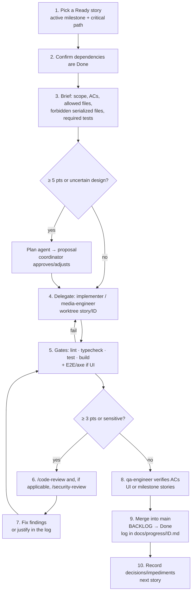

# Orchestration with Claude Code

Based on the tools **actually verified** in this environment (2026-10-28): `Agent` tool with types `general-purpose`, `Explore`, `Plan`; isolation via `git worktree`; skills `code-review`, `security-review`, `simplify`, `run`; no relevant MCPs; no project agents/hooks. Project agents (`.claude/agents/*.md`) **did not exist yet** at planning time — they are created in FND-01.

## 1. Roles

| Role | Implementation | Rationale | Responsible for | Must not |
|---|---|---|---|---|
| **Coordinator** | Main Claude Code session | A single decision point avoids contradictory architecture | Selecting stories, defining scope, delegating, running gates, integrating, updating `BACKLOG.md`/`DECISIONS.md`, talking to the user | Skip gates; publish without approval |
| **Implementer** | Project agent `implementer` (general-purpose based) in a worktree | Parallelize independent stories without polluting the coordinator's context | Implementing ONE story + tests, within the defined file scope | Edit serialized files, BACKLOG, ADRs; change dependencies without authorization in the brief |
| **Media/protocol specialist** | Agent `media-engineer` | Specific domain (Xtream, M3U, HLS/TS, MSE/MMS, codecs, EPG) with its own rules | Stories PLY-*, SRC-02/04/07, VOD-04, EPG-*, S-00 | UI decisions outside the player |
| **QA engineer** | Agent `qa-engineer` | Independent verification: writes tests from the ACs, not from the implementation | QA-*, E2E tests for each milestone, AC verification before `Done` | Fix production code (reports to the coordinator) |
| **Code review** | Skill `/code-review` (built-in) | Already exists; do not duplicate with a dedicated agent | Review of stories ≥ 3 pts or sensitive | — |
| **Security review** | Skill `/security-review` (built-in) | Already exists | Stories in `core/crypto`, `core/net`, `core/log`, parsers, CSP, SW, proxy | — |
| Architecture | **No permanent agent**; built-in `Plan` agent on demand for stories ≥ 5 pts | Decisions are already in ADRs; a permanent agent would create competing decisions | Design proposal before implementing | Change ADRs (only proposes) |
| UX/UI | **No permanent agent**; validation via screenshots (`run` skill/Playwright), axe and a human checkpoint | The visual system is specified in `UX_UI.md`; the final visual judgment is the user's | — | — |

Total: 3 project agents + 2 built-in skills + occasional `Plan`. Recommended maximum parallelism: **3 simultaneous implementers** (review and integration are the bottleneck).

## 2. Per-story cycle (coordinator)



States: `Ready` → (step 4) `In Progress` → (step 6) `In Review` → (step 9) `Done`. Any blocker → `Blocked` + a row in the impediment log of `BACKLOG.md`.

## 3. Delegation brief (template)

```
Story: <ID> — <title>   (see docs/USER_STORIES.md#<id>)
Goal: <1 sentence>
Acceptance criteria: <copied>
Allowed files/folders: <list>
Forbidden files (serialized): see AGENT_WORKFLOW §5 — if you need to change one, STOP and describe the required change in the report.
Contracts to respect: <relevant interfaces from ARCHITECTURE.md §4>
Required tests: <list>
Already decided (do not reopen): <relevant ADRs>
Language: all code, comments, tests and commit messages in English; user-facing text only via src/i18n/en/<feature>.ts + src/i18n/pt-PT/<feature>.ts.
Commits: `<ID>: <summary>` in English, imperative mood (e.g. `SRC-02: normalize Xtream server URL`).
Deliverable: summary of changes, commands run and results (paste real output), ACs met/not met, risks, requested changes to serialized files.
Do not: commit outside the worktree, install unlisted dependencies, publish, change BACKLOG/DECISIONS.
```

## 4. General rules
1. One story = one branch `story/<ID>` = one worktree (when in parallel) = one merge.
2. Commit messages in English, imperative mood, formatted `<ID>: <summary>` (e.g. `SRC-02: normalize Xtream server URL`); non-story commits use a conventional type (`docs:`, `chore:`, `ci:`).
3. No agent declares an AC met without a test or a recorded verification with real output.
4. Architecture divergence → the agent stops and reports; the coordinator writes an ADR or rejects it.
5. Real credentials never in files, agent prompts, commits, fixtures or logs. S-00 receives credentials only at runtime from the user.
6. Publishing (DEP-01), account creation, repository visibility changes: always with explicit user approval.

## 5. Conflict prevention

**Serialized files** (only one agent at a time, and only when the brief explicitly authorizes it; by default, only the coordinator):
- `package.json`, `package-lock.json`
- `vite.config.ts`, `tsconfig*.json`, `eslint.config.*`, `playwright.config.ts`, `vitest.config.ts`
- `src/core/db/schema.ts` (and migrations)
- `src/app/router.tsx`, `src/app/AppShell.tsx`
- `src/ui/theme/**`
- `.github/workflows/**`, `public/manifest*`, SW configuration
- `docs/BACKLOG.md`, `docs/DECISIONS.md`, `CLAUDE.md`, `.claude/**`

**To reduce contention points:**
- Strings per feature: `src/i18n/en/<feature>.ts` (base, defines the types) + `src/i18n/pt-PT/<feature>.ts` (ADR-015), aggregated by a generated index, instead of a single file.
- Routes registered per feature (`features/<x>/routes.tsx`) and mounted in the router — the router only changes when a new feature is born.
- Dexie schema: changes grouped and made by the coordinator before launching the stories that depend on them.
- Two stories of the same wave that touch the same feature folder do not run in parallel.

**Duplicate work:** before delegating, the coordinator checks (`Explore`) whether an equivalent utility already exists and points to it in the brief.

**Integration:** sequential merges by the coordinator; after each merge, the gates run on `main` before the next merge; subsequent worktrees rebase.

## 6. Agents created in FND-01 (contents)

These must match the files in `.claude/agents/`.

`.claude/agents/implementer.md`
```markdown
---
name: implementer
description: Implements a single Simple IPTV backlog story within the file scope given in the brief, with tests. Use for stories that are not media/protocol stories.
---
Read CLAUDE.md, docs/ARCHITECTURE.md and the story in docs/USER_STORIES.md before starting.

Rules:
- Implement only the scope of the brief. Write tests for every acceptance criterion.
- Run `npm run lint`, `npm run typecheck`, `npm test` and `npm run build` and paste the real output into the report.
- Never edit serialized files (docs/AGENT_WORKFLOW.md §5) — describe the required change in the report.
- Never use real credentials. Use the redacting logger (`@/core/log`), never `console`.
- Write code, comments, tests and commit messages in English; user-facing text only via `src/i18n/en` + `src/i18n/pt-PT`.
- UI strings in `src/i18n/en/<feature>.ts` (base, defines the types) + `src/i18n/pt-PT/<feature>.ts`.
- If the design requires diverging from an ADR (docs/DECISIONS.md), stop and report.
- Do not install dependencies that are not in the brief. Do not publish anything.

Final report: changes, commands and results, ACs met/not met, risks, requests for changes to serialized files.
```

`.claude/agents/media-engineer.md`
```markdown
---
name: media-engineer
description: Specialist in IPTV protocols (Xtream Codes, M3U, XMLTV) and in-browser playback (hls.js, mpegts.js, MSE/ManagedMediaSource, codecs). Use for stories PLY-*, SRC-02/04/07, VOD-04, EPG-* and S-00.
---
Follow all the rules of the `implementer` agent (.claude/agents/implementer.md). Additionally:
- Respect docs/RESEARCH.md §5–§9 (engine selection, browser limitations, formats, Xtream API).
- Treat server responses and lists as untrusted: tolerant Valibot validation, item by item.
- Destroy engines, remove listeners and revoke ObjectURLs; test for leaks.
- Do not promise compatibility: document what was tested, where and with which version.
- Never implement circumvention of DRM, authentication or access restrictions.
- Write code, comments, tests and commit messages in English; user-facing text only via `src/i18n/en` + `src/i18n/pt-PT`.
```

`.claude/agents/qa-engineer.md`
```markdown
---
name: qa-engineer
description: Independently verifies the acceptance criteria of a Simple IPTV story or milestone and writes tests (Vitest, Playwright, axe). Does not change production code.
---
- Start from the acceptance criteria in docs/USER_STORIES.md, not from the implementation.
- Write/update tests only in `src/**/*.test.ts(x)`, `e2e/**` and `fixtures/**`.
- Run the relevant suite and report AC by AC: met / not met / not verifiable, with evidence (real output).
- If you find a defect, describe the reproduction steps; do not fix it.
- Never use real IPTV provider data or URLs in fixtures.
- Write code, comments, tests and commit messages in English; user-facing text only via `src/i18n/en` + `src/i18n/pt-PT`.
```

## 7. Hooks and automation (proposals — not configured)
| Hook | Action | Benefit | Decision |
|---|---|---|---|
| `PostToolUse` on `Edit|Write` for `*.ts(x)` | `prettier --write <file>` | Consistent formatting across agents | Propose in FND-01 (requires approval) |
| `PreToolUse` on `Bash` | Block `git push --force`, `rm -rf` outside `dist/`/`coverage/` | Safety | Optional |
| `Stop` | Reminder to update `BACKLOG.md` | Traceability | Optional |

## 8. Progress log
- `docs/progress/<ID>.md` per story: scope, decisions, commands and results, review findings and resolution, open items.
- `docs/progress/compatibility-matrix.md` (DEP-02 and S-00).
- `BACKLOG.md` is the single source of status.
