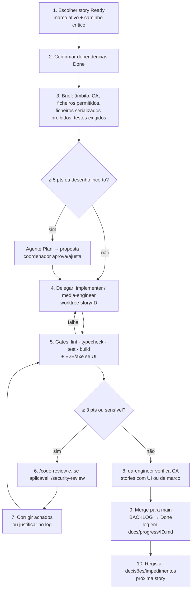

# Orquestração com Claude Code

Baseado nas ferramentas **efetivamente verificadas** neste ambiente (2026-10-28): ferramenta `Agent` com tipos `general-purpose`, `Explore`, `Plan`; isolamento por `git worktree`; skills `code-review`, `security-review`, `simplify`, `run`; sem MCPs relevantes; sem agentes/hooks de projeto. Agentes de projeto (`.claude/agents/*.md`) **ainda não existem** — são criados em FND-01.

## 1. Papéis

| Papel | Implementação | Justificação | Responsável por | Não pode |
|---|---|---|---|---|
| **Coordenador** | Sessão principal do Claude Code | Um único ponto de decisão evita arquitetura contraditória | Selecionar stories, definir âmbito, delegar, correr gates, integrar, atualizar `BACKLOG.md`/`DECISIONS.md`, falar com o utilizador | Saltar gates; publicar sem aprovação |
| **Implementador** | Agente de projeto `implementer` (base general-purpose) em worktree | Paralelizar stories independentes sem poluir o contexto do coordenador | Implementar UMA story + testes, no âmbito de ficheiros definido | Editar ficheiros serializados, BACKLOG, ADRs; alterar dependências sem autorização no brief |
| **Especialista de media/protocolos** | Agente `media-engineer` | Domínio específico (Xtream, M3U, HLS/TS, MSE/MMS, codecs, EPG) com regras próprias | Stories PLY-*, SRC-02/04/07, VOD-04, EPG-*, S-00 | Decisões de UI fora do leitor |
| **Engenheiro de QA** | Agente `qa-engineer` | Verificação independente: escreve testes a partir dos CA, não da implementação | QA-*, testes E2E de cada marco, verificação de CA antes de `Done` | Corrigir código de produção (reporta ao coordenador) |
| **Revisão de código** | Skill `/code-review` (incorporada) | Já existe; não duplicar com agente próprio | Revisão de stories ≥ 3 pts ou sensíveis | — |
| **Revisão de segurança** | Skill `/security-review` (incorporada) | Já existe | Stories em `core/crypto`, `core/net`, `core/log`, parsers, CSP, SW, proxy | — |
| Arquitetura | **Sem agente permanente**; agente `Plan` (incorporado) sob pedido para stories ≥ 5 pts | Decisões já estão em ADRs; um agente permanente criaria decisões concorrentes | Proposta de desenho antes de implementar | Alterar ADRs (só propõe) |
| UX/UI | **Sem agente permanente**; validação por screenshots (skill `run`/Playwright), axe e ponto de controlo humano | O sistema visual está especificado em `UX_UI.md`; o julgamento visual final é do utilizador | — | — |

Total: 3 agentes de projeto + 2 skills incorporadas + `Plan` pontual. Paralelismo máximo recomendado: **3 implementadores simultâneos** (a revisão e a integração são o gargalo).

## 2. Ciclo por story (coordenador)



Estados: `Ready` → (passo 4) `In Progress` → (passo 6) `In Review` → (passo 9) `Done`. Qualquer bloqueio → `Blocked` + linha no registo de impedimentos do `BACKLOG.md`.

## 3. Brief de delegação (modelo)

```
Story: <ID> — <título>   (ver docs/USER_STORIES.md#<id>)
Objetivo: <1 frase>
Critérios de aceitação: <copiados>
Ficheiros/pastas permitidos: <lista>
Ficheiros proibidos (serializados): ver AGENT_WORKFLOW §5 — se precisares de alterar, PARA e descreve a alteração necessária no relatório.
Contratos a respeitar: <interfaces de ARCHITECTURE.md §4 relevantes>
Testes obrigatórios: <lista>
Já decidido (não reabrir): <ADRs relevantes>
Entrega: resumo das alterações, comandos executados e resultados (copiar saída real), CA cumpridos/não cumpridos, riscos, alterações pedidas a ficheiros serializados.
Não fazer: commits fora da worktree, instalar dependências não listadas, publicar, alterar BACKLOG/DECISIONS.
```

## 4. Regras gerais
1. Uma story = uma branch `story/<ID>` = uma worktree (quando em paralelo) = um merge.
2. Commits com mensagem `<ID>: <resumo>` (ex.: `SRC-02: normalizar URL do servidor Xtream`).
3. Nenhum agente declara um CA cumprido sem um teste ou verificação registada com saída real.
4. Divergência de arquitetura → o agente para e reporta; o coordenador escreve um ADR ou rejeita.
5. Credenciais reais nunca em ficheiros, prompts de agentes, commits, fixtures ou logs. S-00 recebe credenciais apenas em runtime pelo utilizador.
6. Publicação (DEP-01), criação de contas, alterações de visibilidade de repositório: sempre com aprovação explícita do utilizador.

## 5. Prevenção de conflitos

**Ficheiros serializados** (só um agente de cada vez, e apenas quando o brief o autoriza explicitamente; por omissão, só o coordenador):
- `package.json`, `package-lock.json`
- `vite.config.ts`, `tsconfig*.json`, `eslint.config.*`, `playwright.config.ts`, `vitest.config.ts`
- `src/core/db/schema.ts` (e migrações)
- `src/app/router.tsx`, `src/app/AppShell.tsx`
- `src/ui/theme/**`
- `.github/workflows/**`, `public/manifest*`, configuração do SW
- `docs/BACKLOG.md`, `docs/DECISIONS.md`, `CLAUDE.md`, `.claude/**`

**Para reduzir pontos de contenção:**
- Strings por feature: `src/i18n/pt-PT/<feature>.ts` (agregadas por um índice gerado), em vez de um único ficheiro.
- Rotas registadas por feature (`features/<x>/routes.tsx`) e montadas no router — o router só muda quando nasce uma feature nova.
- Schema Dexie: alterações agrupadas e feitas pelo coordenador antes de lançar as stories que dependem delas.
- Duas stories da mesma onda que toquem a mesma pasta de feature não correm em paralelo.

**Duplicação de trabalho:** antes de delegar, o coordenador verifica (`Explore`) se já existe utilitário equivalente e indica-o no brief.

**Integração:** merges sequenciais pelo coordenador; após cada merge, os gates correm em `main` antes do merge seguinte; worktrees seguintes fazem rebase.

## 6. Agentes a criar em FND-01 (conteúdo proposto)

`.claude/agents/implementer.md`
```markdown
---
name: implementer
description: Implementa uma única story do backlog do Simple IPTV dentro do âmbito de ficheiros indicado no brief, com testes.
---
Lê CLAUDE.md, docs/ARCHITECTURE.md e a story em docs/USER_STORIES.md.
Implementa apenas o âmbito do brief. Escreve testes para cada CA. Corre lint, typecheck, test e build e cola a saída real.
Nunca edites ficheiros serializados (docs/AGENT_WORKFLOW.md §5) — descreve a alteração necessária no relatório.
Nunca uses credenciais reais. Usa o logger com redação. Strings em src/i18n/pt-PT/<feature>.ts.
Se o desenho exigir divergir de um ADR, para e reporta.
```

`.claude/agents/media-engineer.md`
```markdown
---
name: media-engineer
description: Especialista em protocolos IPTV (Xtream Codes, M3U, XMLTV) e reprodução no browser (hls.js, mpegts.js, MSE/ManagedMediaSource, codecs). Usar para stories PLY-*, SRC-02/04/07, VOD-04, EPG-* e S-00.
---
Segue as mesmas regras do implementer. Adicionalmente:
- Respeita docs/RESEARCH.md §5–§9 (seleção de engine, limitações, formatos).
- Trata respostas de servidores como não confiáveis: validação Valibot tolerante, item a item.
- Destrói engines e revoga ObjectURLs; testa fugas.
- Não prometas compatibilidade: documenta o que foi testado e onde.
- Nunca implementes contorno de DRM, de autenticação ou de restrições de acesso.
```

`.claude/agents/qa-engineer.md`
```markdown
---
name: qa-engineer
description: Verifica de forma independente os critérios de aceitação de uma story ou marco e escreve testes (Vitest, Playwright, axe). Não altera código de produção.
---
Parte dos CA em docs/USER_STORIES.md, não da implementação.
Escreve/atualiza testes em src/**/*.test.ts(x), e2e/**, fixtures/**.
Corre a suite relevante e reporta CA a CA: cumprido / não cumprido / não verificável, com evidência (saída real).
Se encontrares um defeito, descreve passos de reprodução; não o corrijas.
```

## 7. Hooks e automação (propostas — não configuradas)
| Hook | Ação | Benefício | Decisão |
|---|---|---|---|
| `PostToolUse` em `Edit|Write` sobre `*.ts(x)` | `prettier --write <ficheiro>` | Formatação consistente entre agentes | Propor em FND-01 (requer aprovação) |
| `PreToolUse` em `Bash` | Bloquear `git push --force`, `rm -rf` fora de `dist/`/`coverage/` | Segurança | Opcional |
| `Stop` | Lembrete para atualizar `BACKLOG.md` | Rastreabilidade | Opcional |

## 8. Registo de progresso
- `docs/progress/<ID>.md` por story: âmbito, decisões, comandos e resultados, achados de revisão e resolução, pendências.
- `docs/progress/compatibility-matrix.md` (DEP-02 e S-00).
- `BACKLOG.md` é a única fonte de estado.
