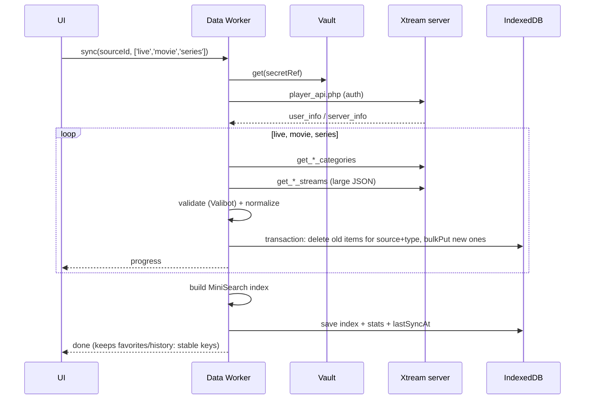
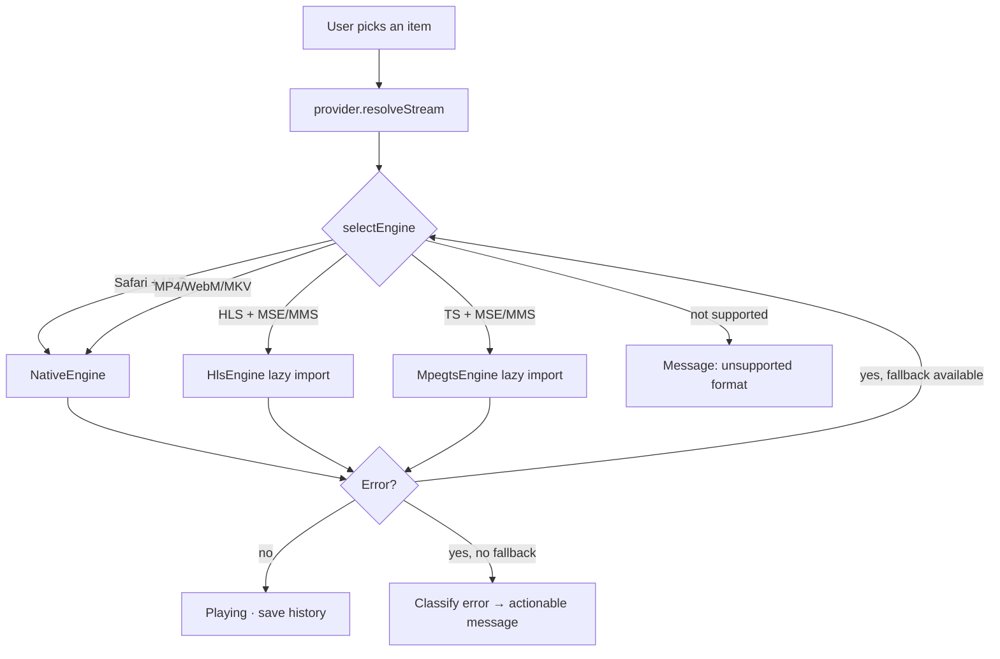

# Technical architecture

> Based on the decisions in `DECISIONS.md` and the research in `RESEARCH.md`. Nothing here is implemented.

## 1. Overview


There is no backend. The host only serves the app; **no user data and no video goes through the host**.

## 2. Proposed directory structure

```
simple_iptv/
├─ index.html
├─ public/                 # icons, manifest assets, robots.txt
├─ src/
│  ├─ app/                 # bootstrap, router, providers, layout (AppShell)
│  ├─ ui/                  # design system: theme, tokens, shared components
│  ├─ i18n/                # en/<feature>.ts + pt-PT/<feature>.ts + index (ADR-015)
│  ├─ core/
│  │  ├─ db/               # Dexie schema, migrations, repositories
│  │  ├─ net/              # httpClient, error classification, UrlRewriter
│  │  ├─ crypto/           # CredentialVault
│  │  ├─ log/              # logger with redaction
│  │  ├─ worker/           # generic worker runtime: Comlink API, client, TaskContext, errors
│  │  └─ platform/         # capability detection (MSE/MMS, codecs, iOS, standalone)
│  ├─ providers/
│  │  ├─ xtream/           # client, schemas, mapping → internal model
│  │  └─ m3u/              # streaming parser, classification heuristics
│  ├─ worker/              # worker composition root: task registry + data.worker.ts entry (ADR-016)
│  ├─ player/              # PlayerEngine, engines, selectEngine, PlayerView, controls
│  ├─ features/
│  │  ├─ onboarding/
│  │  ├─ sources/
│  │  ├─ live/
│  │  ├─ movies/
│  │  ├─ series/
│  │  ├─ epg/
│  │  ├─ favorites/        # favorites + recents + resume
│  │  ├─ search/
│  │  └─ settings/
│  └─ test/                # shared utilities and fixtures
├─ e2e/                    # Playwright
├─ fixtures/               # synthetic M3U/Xtream/XMLTV (no real data)
└─ docs/
```

Dependency rule: `features → (worker, player, providers, core, ui)`; `worker → (providers, core)`; `providers → core`; `core` imports nothing from above; features do not import from each other except via routes or `core/db` (enforceable with `eslint-plugin-boundaries` or `no-restricted-imports` rules).

## 3. Modules and responsibilities

| Module | Responsibility | Does not |
|---|---|---|
| `core/net` | `fetchJson/fetchText/fetchStream` with timeout, `AbortSignal`, error classification, applying the `UrlRewriter` | Domain logic |
| `core/crypto` | Generate/get the device key; `encrypt/decrypt`; `wipe()` | Store domain data |
| `core/db` | Dexie schema, migrations, typed repositories, `wipeAll()` | Network requests |
| `core/log` | `log.debug/info/warn/error` with automatic redaction; 500-entry ring buffer | Remote sending |
| `core/worker` | Heavy operations (sync, parse, index) with progress and cancellation | DOM access |
| `core/platform` | `capabilities()`: MSE/MMS, `isTypeSupported` for common codecs, iOS, standalone, PiP, fullscreen | — |
| `providers/xtream` | Implements `SourceProvider` for Xtream | UI |
| `providers/m3u` | Streaming M3U parser + `SourceProvider` for M3U | UI |
| `player` | Engine selection, lifecycle, events, player UI | Know where the stream comes from |
| `features/*` | Screens and flows | Access `fetch` directly |

## 4. Contracts between modules (TypeScript, indicative)

```ts
// core/net
export type NetErrorKind =
  | 'offline' | 'timeout' | 'aborted'
  | 'blocked'        // TypeError in fetch: CORS, mixed content or DNS — the browser does not distinguish
  | 'http'           // status != 2xx
  | 'auth'           // 401/403 or user_info.auth === 0
  | 'parse';
export class NetError extends Error { kind: NetErrorKind; status?: number; hint?: 'mixed-content' | 'cors' }
export interface UrlRewriter { rewrite(url: string, purpose: 'api' | 'playlist' | 'stream' | 'image' | 'epg'): string }

// core/crypto
export interface CredentialVault {
  put(ref: string, secret: string): Promise<void>;
  get(ref: string): Promise<string | undefined>;
  delete(ref: string): Promise<void>;
  wipe(): Promise<void>;
}

// providers
export type ContentType = 'live' | 'movie' | 'series';
export interface SyncProgress { phase: string; done: number; total?: number }
export interface SourceProvider {
  testConnection(signal?: AbortSignal): Promise<ConnectionReport>;
  sync(types: ContentType[], onProgress: (p: SyncProgress) => void, signal?: AbortSignal): Promise<SyncResult>;
  getMovieDetails?(movieId: string): Promise<MovieDetails>;
  getSeriesDetails?(seriesId: string): Promise<SeriesDetails>;      // seasons + episodes
  getNowNext?(channelId: string): Promise<EpgProgram[]>;
  resolveStream(item: PlayableRef, prefs: StreamPrefs): Promise<StreamDescriptor>;
}
export interface ConnectionReport {
  ok: boolean;
  https: boolean;
  corsApi: 'ok' | 'blocked' | 'unknown';
  account?: { status: string; expiresAt?: number; maxConnections?: number; activeConnections?: number; formats: string[] };
  problems: Array<{ code: string; message: string; fix?: string }>;
}

// player
export interface StreamDescriptor {
  url: string;
  kind: 'live' | 'vod';
  container: 'hls' | 'ts' | 'mp4' | 'mkv' | 'webm' | 'flv' | 'unknown';
  fallbacks?: StreamDescriptor[];       // e.g. .m3u8 as an alternative to .ts
}
export interface PlayerEngine {
  readonly id: 'native' | 'hls' | 'mpegts';
  attach(video: HTMLVideoElement): void;
  load(stream: StreamDescriptor, startAt?: number): Promise<void>;
  destroy(): Promise<void>;
  audioTracks(): Track[]; setAudioTrack(id: string): void;   // post-MVP
  textTracks(): Track[];  setTextTrack(id: string | null): void;
  on(evt: 'error', cb: (e: PlaybackError) => void): () => void;
}
export type PlaybackErrorKind = 'network' | 'blocked' | 'unsupported-container' | 'unsupported-codec' | 'decode' | 'auth' | 'unknown';
export function selectEngine(s: StreamDescriptor, caps: Capabilities): PlayerEngine['id'] | 'unsupported';

// search (worker)
export interface SearchApi {
  build(sourceId: string): Promise<void>;
  query(q: string, opts?: { types?: ContentType[]; limit?: number }): Promise<SearchHit[]>;
}
```

## 5. Data model (IndexedDB / Dexie v1)

Catalog keys are composite: `key = "${sourceId}:${type}:${externalId}"` — allows several sources without collisions and deleting a source by prefix/index.

| Table | Key | Indexes | Main fields |
|---|---|---|---|
| `sources` | `id` (uuid) | `createdAt` | `kind: 'xtream'|'m3u-url'|'m3u-file'`, `name`, `serverUrl?`, `username?`, `secretRef?` (→ vault; absent for M3U files), `epgUrl?`, `prefs {liveFormat:'auto'|'ts'|'m3u8'}`, `lastSyncAt?`, `lastSyncStatus`, `stats {live, movies, series}` |
| `secrets` | `ref` | — | `iv`, `ciphertext` (AES-GCM) |
| `keys` | `id` | — | non-extractable `CryptoKey` |
| `categories` | `key` | `[sourceId+type]`, `sourceId` | `name`, `order` |
| `channels` | `key` | `[categoryKey+order]`, `sourceId`, `nameNorm` | `name`, `logo?`, `number?`, `epgId?`, `streamPath`*, `catchup?` |
| `movies` | `key` | `[categoryKey+order]`, `sourceId`, `addedAt` | `name`, `poster?`, `rating?`, `year?`, `ext?`, `streamPath`* |
| `series` | `key` | `[categoryKey+order]`, `sourceId` | `name`, `cover?`, `plot?`, `rating?`, `year?` |
| `seriesDetails` | `seriesKey` | `fetchedAt` | seasons + episodes (cache TTL 24 h) |
| `favorites` | `itemKey` | `[sourceId+type]`, `addedAt` | `type` |
| `history` | `itemKey` | `[sourceId+type]`, `lastWatchedAt` | `positionSec?`, `durationSec?`, `episodeKey?`, `completed` |
| `epgPrograms` | `[channelEpgId+start]` | `end`, `sourceId` | `title`, `desc?` (post-MVP, XMLTV) |
| `settings` | `key` | — | `theme`, `locale` (ADR-015), `activeSourceId`, `lastRoute`, `lastChannelKey`, `onboardingDone` |
| `searchIndex` | `sourceId` | — | serialized MiniSearch index (`toJSON`) |

\* `streamPath`: for Xtream only `id` + extension are stored; the full URL is built in memory with the credentials (`resolveStream`). For M3U, encrypting each URL individually has a prohibitive cost on 100k-entry lists; decision: store the URL in plain text in the `channels` table and document it (see `SECURITY.md §2`); if the list is an Xtream `get.php` type, offer conversion to an Xtream source (encrypted credentials, URLs built in memory).

Implementation notes (FND-05):
- Catalog items have `order` (the source's original order) and `categoryKey?`; pagination uses the `[categoryKey+order]` index with `offset/limit` (reads only the requested page).
- `replaceForSource` deduplicates by key (last one wins) and returns the counts actually written + `duplicates`.
- The vault (`core/crypto`, SRC-01) accesses the `secrets`/`keys` tables through `vaultStore`, without `db.table()`.
- `DatabaseUnavailableError.reason` ∈ `unsupported|open-failed|timeout`; the user-facing text comes from `t.db.errors[reason]` (`src/i18n/<locale>/db.ts`, ADR-015).
- `closeDatabase()` is asynchronous; `wipeAll()` closes connections and cancels pending opens before deleting.

Migrations: `db.version(n).stores(...).upgrade(...)`; each schema change is its own story and goes through review (shared file — see the conflict policy).

## 6. Main flows

### 6.1 Syncing an Xtream source


### 6.2 Playback


## 7. Cache and sync

| Data | Where | Policy |
|---|---|---|
| App shell (HTML/JS/CSS/fonts/icons) | SW precache | Versioned per build; update with prompt |
| Catalog (categories, channels, movies, series) | IndexedDB | Manual refresh + automatic if `lastSyncAt` > 24 h (configurable), in the background while the app is open |
| Movie / series details | IndexedDB (`seriesDetails`) + TanStack Query | TTL 24 h |
| EPG now/next (Xtream) | TanStack Query (memory) | `staleTime` 5 min; only for visible/selected channels |
| XMLTV EPG (post-MVP) | IndexedDB | Window −2 h/+48 h; refresh 12 h; purge of finished programs |
| Logos/posters | Browser HTTP cache | **No** SW cache (opaque responses) |
| Xtream API and streams | Never in the SW | `NetworkOnly`; URLs with credentials never enter Cache Storage |

## 8. Error handling and logging
- All network errors go through `NetError` with a `kind`; the UI maps `kind` → a localized message (active locale, ADR-015) with a suggested action (e.g. `blocked` + `http:` server → "This server doesn't use HTTPS; browsers block this access from a secure app. See options.").
- `log` applies redaction before any output: it replaces `username=`, `password=`, `/live|movie|series/{u}/{p}/` segments, `token=`, and any value present in the vault with `***`.
- One `ErrorBoundary` per route; never show stack traces to the user.

## 9. Is the MVP possible without a backend?
**Yes, for providers with HTTPS + CORS, for M3U lists imported from a file with HTTPS streams, and for HLS on Safari (no CORS needed).** No, for HTTP-only providers — in those cases no client-side code can get around the browser block. The proposed solution (ADR-010) is a proxy **operated by the user themselves**, never a central service of ours, for three reasons: (1) we do not hold third-party credentials or traffic; (2) zero cost is maintained; (3) it avoids the terms-of-service risks of CDNs that forbid video.

## 10. Performance (design decisions)
- Lists are always virtualized; images with `loading="lazy"` + `decoding="async"` + fixed dimensions.
- Never load the whole catalog into UI memory: paginated queries per category via Dexie indexes.
- hls.js (full build ~179 KB gz, ADR-017) and mpegts.js (~62 KB gz) only on first play; the service worker precaches them so later first plays are instant.
- Reuse the same `<video>` when zapping; `destroy()` the previous engine before `load()`.
- Search in the worker with a 120 ms debounce.
