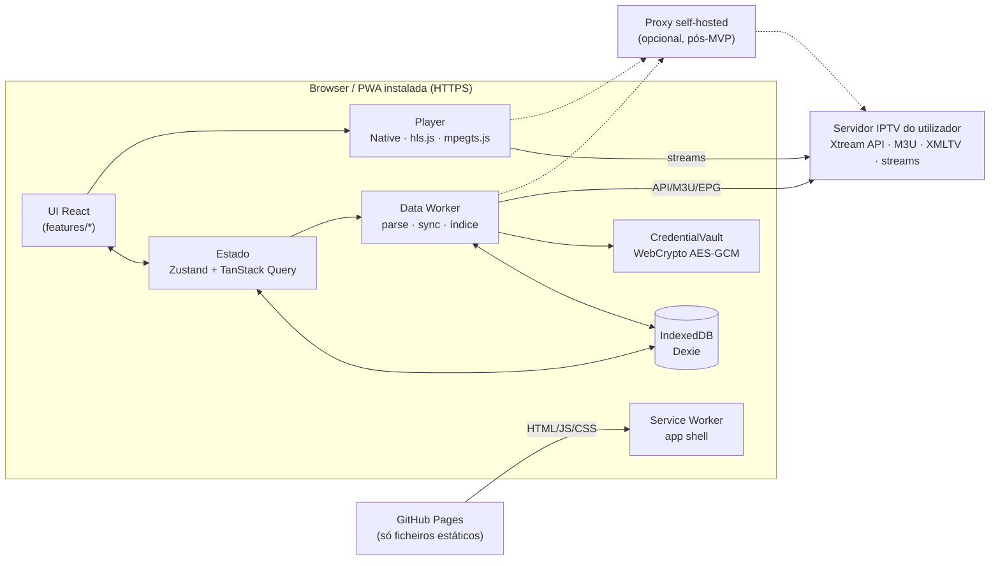
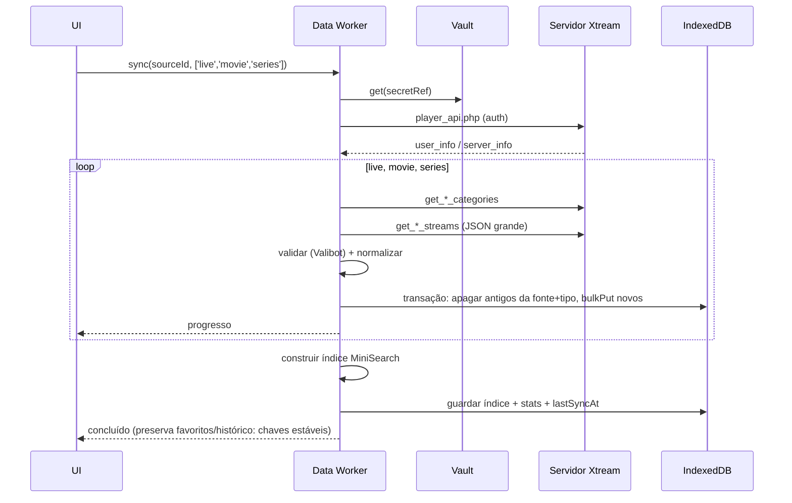
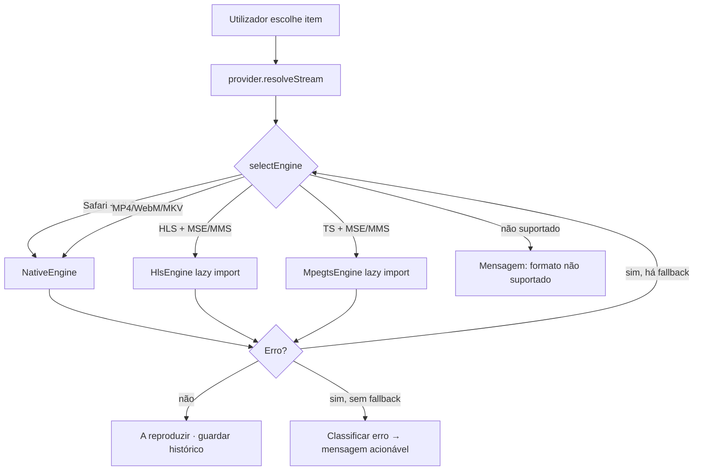

# Arquitetura técnica

> Baseada nas decisões de `DECISIONS.md` e na investigação de `RESEARCH.md`. Nada aqui está implementado.

## 1. Visão geral



Não existe backend. O alojamento só serve a app; **nenhum dado do utilizador nem vídeo passa pelo alojamento**.

## 2. Estrutura de diretórios proposta

```
simple_iptv/
├─ index.html
├─ public/                 # ícones, manifest assets, robots.txt
├─ src/
│  ├─ app/                 # bootstrap, router, providers, layout (AppShell)
│  ├─ ui/                  # design system: tema, tokens, componentes partilhados
│  ├─ i18n/                # pt-PT/<feature>.ts + índice
│  ├─ core/
│  │  ├─ db/               # Dexie schema, migrações, repositórios
│  │  ├─ net/              # httpClient, classificação de erros, UrlRewriter
│  │  ├─ crypto/           # CredentialVault
│  │  ├─ log/              # logger com redação
│  │  ├─ worker/           # data.worker.ts + API Comlink
│  │  └─ platform/         # deteção de capacidades (MSE/MMS, codecs, iOS, standalone)
│  ├─ providers/
│  │  ├─ xtream/           # cliente, schemas, mapeamento → modelo interno
│  │  └─ m3u/              # parser streaming, heurísticas de classificação
│  ├─ player/              # PlayerEngine, engines, selectEngine, PlayerView, controlos
│  ├─ features/
│  │  ├─ onboarding/
│  │  ├─ sources/
│  │  ├─ live/
│  │  ├─ movies/
│  │  ├─ series/
│  │  ├─ epg/
│  │  ├─ favorites/        # favoritos + recentes + retomar
│  │  ├─ search/
│  │  └─ settings/
│  └─ test/                # utilitários e fixtures partilhados
├─ e2e/                    # Playwright
├─ fixtures/               # M3U/Xtream/XMLTV sintéticos (sem dados reais)
└─ docs/
```

Regra de dependência: `features → (player, providers, core, ui)`; `providers → core`; `core` não importa nada de cima; features não importam umas das outras exceto via rotas ou `core/db` (verificável com `eslint-plugin-boundaries` ou regras `no-restricted-imports`).

## 3. Módulos e responsabilidades

| Módulo | Responsabilidade | Não faz |
|---|---|---|
| `core/net` | `fetchJson/fetchText/fetchStream` com timeout, `AbortSignal`, classificação de erros, aplicação do `UrlRewriter` | Lógica de domínio |
| `core/crypto` | Gerar/obter chave de dispositivo; `encrypt/decrypt`; `wipe()` | Guardar dados de domínio |
| `core/db` | Schema Dexie, migrações, repositórios tipados, `wipeAll()` | Pedidos de rede |
| `core/log` | `log.debug/info/warn/error` com redação automática; ring buffer de 500 entradas | Envio remoto |
| `core/worker` | Operações pesadas (sync, parse, índice) com progresso e cancelamento | Acesso ao DOM |
| `core/platform` | `capabilities()`: MSE/MMS, `isTypeSupported` para codecs comuns, iOS, standalone, PiP, fullscreen | — |
| `providers/xtream` | Implementa `SourceProvider` para Xtream | UI |
| `providers/m3u` | Parser M3U streaming + `SourceProvider` para M3U | UI |
| `player` | Seleção de engine, ciclo de vida, eventos, UI do leitor | Saber de onde vem o stream |
| `features/*` | Ecrãs e fluxos | Aceder a `fetch` diretamente |

## 4. Contratos entre módulos (TypeScript, indicativo)

```ts
// core/net
export type NetErrorKind =
  | 'offline' | 'timeout' | 'aborted'
  | 'blocked'        // TypeError em fetch: CORS, mixed content ou DNS — o browser não distingue
  | 'http'           // status != 2xx
  | 'auth'           // 401/403 ou user_info.auth === 0
  | 'parse';
export class NetError extends Error { kind: NetErrorKind; status?: number; hint?: 'mixed-content' | 'cors' }
export interface UrlRewriter { rewrite(url: string, purpose: 'api' | 'playlist' | 'stream' | 'image' | 'epg'): string }

// core/crypto
export interface CredentialVault {
  put(ref: string, secret: string): Promise<void>;
  get(ref: string): Promise<string | undefined>;
  delete(ref: string): Promise<void>;
  wipe(): Promise<void>;
}

// providers
export type ContentType = 'live' | 'movie' | 'series';
export interface SyncProgress { phase: string; done: number; total?: number }
export interface SourceProvider {
  testConnection(signal?: AbortSignal): Promise<ConnectionReport>;
  sync(types: ContentType[], onProgress: (p: SyncProgress) => void, signal?: AbortSignal): Promise<SyncResult>;
  getMovieDetails?(movieId: string): Promise<MovieDetails>;
  getSeriesDetails?(seriesId: string): Promise<SeriesDetails>;      // temporadas + episódios
  getNowNext?(channelId: string): Promise<EpgProgram[]>;
  resolveStream(item: PlayableRef, prefs: StreamPrefs): Promise<StreamDescriptor>;
}
export interface ConnectionReport {
  ok: boolean;
  https: boolean;
  corsApi: 'ok' | 'blocked' | 'unknown';
  account?: { status: string; expiresAt?: number; maxConnections?: number; activeConnections?: number; formats: string[] };
  problems: Array<{ code: string; message: string; fix?: string }>;
}

// player
export interface StreamDescriptor {
  url: string;
  kind: 'live' | 'vod';
  container: 'hls' | 'ts' | 'mp4' | 'mkv' | 'webm' | 'flv' | 'unknown';
  fallbacks?: StreamDescriptor[];       // ex.: .m3u8 como alternativa a .ts
}
export interface PlayerEngine {
  readonly id: 'native' | 'hls' | 'mpegts';
  attach(video: HTMLVideoElement): void;
  load(stream: StreamDescriptor, startAt?: number): Promise<void>;
  destroy(): Promise<void>;
  audioTracks(): Track[]; setAudioTrack(id: string): void;   // pós-MVP
  textTracks(): Track[];  setTextTrack(id: string | null): void;
  on(evt: 'error', cb: (e: PlaybackError) => void): () => void;
}
export type PlaybackErrorKind = 'network' | 'blocked' | 'unsupported-container' | 'unsupported-codec' | 'decode' | 'auth' | 'unknown';
export function selectEngine(s: StreamDescriptor, caps: Capabilities): PlayerEngine['id'] | 'unsupported';

// search (worker)
export interface SearchApi {
  build(sourceId: string): Promise<void>;
  query(q: string, opts?: { types?: ContentType[]; limit?: number }): Promise<SearchHit[]>;
}
```

## 5. Modelo de dados (IndexedDB / Dexie v1)

Chaves de catálogo são compostas: `key = "${sourceId}:${type}:${externalId}"` — permite várias fontes sem colisões e apagar uma fonte por prefixo/índice.

| Tabela | Chave | Índices | Campos principais |
|---|---|---|---|
| `sources` | `id` (uuid) | `createdAt` | `kind: 'xtream'|'m3u-url'|'m3u-file'`, `name`, `serverUrl?`, `username?`, `secretRef?` (→ vault; ausente em ficheiros M3U), `epgUrl?`, `prefs {liveFormat:'auto'|'ts'|'m3u8'}`, `lastSyncAt?`, `lastSyncStatus`, `stats {live, movies, series}` |
| `secrets` | `ref` | — | `iv`, `ciphertext` (AES-GCM) |
| `keys` | `id` | — | `CryptoKey` não exportável |
| `categories` | `key` | `[sourceId+type]`, `sourceId` | `name`, `order` |
| `channels` | `key` | `[categoryKey+order]`, `sourceId`, `nameNorm` | `name`, `logo?`, `number?`, `epgId?`, `streamPath`*, `catchup?` |
| `movies` | `key` | `[categoryKey+order]`, `sourceId`, `addedAt` | `name`, `poster?`, `rating?`, `year?`, `ext?`, `streamPath`* |
| `series` | `key` | `[categoryKey+order]`, `sourceId` | `name`, `cover?`, `plot?`, `rating?`, `year?` |
| `seriesDetails` | `seriesKey` | `fetchedAt` | temporadas + episódios (cache TTL 24 h) |
| `favorites` | `itemKey` | `[sourceId+type]`, `addedAt` | `type` |
| `history` | `itemKey` | `[sourceId+type]`, `lastWatchedAt` | `positionSec?`, `durationSec?`, `episodeKey?`, `completed` |
| `epgPrograms` | `[channelEpgId+start]` | `end`, `sourceId` | `title`, `desc?` (pós-MVP, XMLTV) |
| `settings` | `key` | — | `theme`, `activeSourceId`, `lastRoute`, `lastChannelKey`, `onboardingDone` |
| `searchIndex` | `sourceId` | — | índice MiniSearch serializado (`toJSON`) |

\* `streamPath`: para Xtream guarda-se apenas `id` + extensão; o URL completo é construído em memória com as credenciais (`resolveStream`). Para M3U, cifrar cada URL individualmente tem custo proibitivo em listas de 100k entradas; decisão: guardar o URL em claro na tabela `channels` e documentar (ver `SECURITY.md §2`); se a lista for do tipo `get.php` Xtream, propor conversão para fonte Xtream (credenciais cifradas, URLs construídos em memória).

Notas de implementação (FND-05):
- Itens de catálogo têm `order` (ordem original da fonte) e `categoryKey?`; a paginação usa o índice `[categoryKey+order]` com `offset/limit` (só lê a página pedida).
- `replaceForSource` deduplica por chave (o último vence) e devolve as contagens realmente gravadas + `duplicates`.
- O cofre (`core/crypto`, SRC-01) acede às tabelas `secrets`/`keys` através de `vaultStore`, sem `db.table()`.
- `DatabaseUnavailableError.reason` ∈ `unsupported|open-failed|timeout`; o texto para o utilizador vem de `t.db.errors[reason]` (`src/i18n/pt-PT/db.ts`).
- `closeDatabase()` é assíncrono; `wipeAll()` fecha ligações e cancela aberturas pendentes antes de apagar.

Migrações: `db.version(n).stores(...).upgrade(...)`; cada alteração de schema é uma story própria e passa por revisão (ficheiro partilhado — ver política de conflitos).

## 6. Fluxos principais

### 6.1 Sincronização de uma fonte Xtream


### 6.2 Reprodução


## 7. Cache e sincronização

| Dado | Onde | Política |
|---|---|---|
| App shell (HTML/JS/CSS/fontes/ícones) | Precache do SW | Versão por build; atualização com prompt |
| Catálogo (categorias, canais, filmes, séries) | IndexedDB | Atualização manual + automática se `lastSyncAt` > 24 h (configurável), em segundo plano com a app aberta |
| Detalhe de filme / série | IndexedDB (`seriesDetails`) + TanStack Query | TTL 24 h |
| EPG agora/seguinte (Xtream) | TanStack Query (memória) | `staleTime` 5 min; só para canais visíveis/selecionados |
| EPG XMLTV (pós-MVP) | IndexedDB | Janela −2 h/+48 h; refresh 12 h; expurgo de programas terminados |
| Logos/posters | Cache HTTP do browser | **Sem** cache no SW (respostas opacas) |
| API Xtream e streams | Nunca no SW | `NetworkOnly`; URLs com credenciais nunca entram no Cache Storage |

## 8. Tratamento de erros e logging
- Todos os erros de rede passam por `NetError` com `kind`; a UI mapeia `kind` → mensagem pt-PT com ação sugerida (ex.: `blocked` + servidor `http:` → "O servidor não usa HTTPS; browsers bloqueiam este acesso a partir de uma app segura. Ver opções.").
- `log` aplica redação antes de qualquer saída: substitui `username=`, `password=`, segmentos `/live|movie|series/{u}/{p}/`, `token=`, e qualquer valor presente no vault por `***`.
- `ErrorBoundary` por rota; nunca mostrar stack traces ao utilizador.

## 9. É possível o MVP sem backend?
**Sim, para fornecedores com HTTPS + CORS, para listas M3U importadas de ficheiro com streams HTTPS, e para HLS no Safari (sem CORS).** Não, para fornecedores HTTP-only — nesses casos nenhum código client-side resolve o bloqueio do browser. A solução proposta (ADR-010) é um proxy **operado pelo próprio utilizador**, nunca um serviço central nosso, por três razões: (1) não ficamos com credenciais nem tráfego de terceiros; (2) custo zero mantém-se; (3) evita riscos de termos de serviço de CDNs que proíbem vídeo.

## 10. Desempenho (decisões de desenho)
- Listas sempre virtualizadas; imagens `loading="lazy"` + `decoding="async"` + dimensões fixas.
- Nunca carregar o catálogo inteiro para memória da UI: consultas paginadas por categoria via índices Dexie.
- hls.js (~120 KB gz) e mpegts.js (~60 KB gz) só no primeiro play.
- Reutilizar o mesmo `<video>` ao fazer zapping; `destroy()` da engine anterior antes de `load()`.
- Pesquisa no worker com debounce 120 ms.
