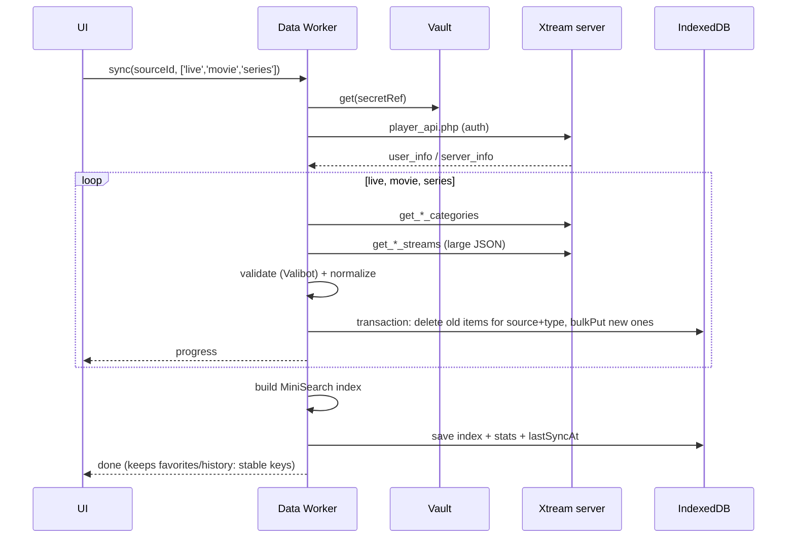
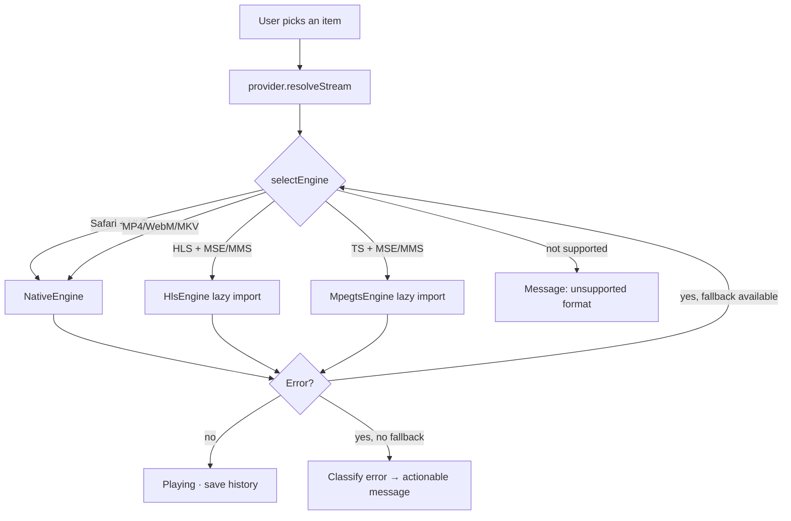

# Technical architecture

> Based on the decisions in `DECISIONS.md` and the research in `RESEARCH.md`. Nothing here is implemented.

## 1. Overview


There is no backend. The host only serves the app; **no user data and no video goes through the host**.

## 2. Proposed directory structure

```
simple_iptv/
├─ index.html
├─ public/                 # icons, manifest assets, robots.txt
├─ src/
│  ├─ app/                 # bootstrap, router, providers, layout (AppShell)
│  ├─ ui/                  # design system: theme, tokens, shared components
│  ├─ i18n/                # en/<feature>.ts + pt-PT/<feature>.ts + index (ADR-015)
│  ├─ core/
│  │  ├─ db/               # Dexie schema, migrations, repositories
│  │  ├─ net/              # httpClient, error classification, UrlRewriter
│  │  ├─ crypto/           # CredentialVault
│  │  ├─ log/              # logger with redaction
│  │  ├─ worker/           # generic worker runtime: Comlink API, client, TaskContext, errors
│  │  └─ platform/         # capability detection (MSE/MMS, codecs, iOS, standalone)
│  ├─ providers/
│  │  ├─ xtream/           # client, schemas, mapping → internal model
│  │  └─ m3u/              # streaming parser, classification heuristics
│  ├─ worker/              # worker composition root: task registry + data.worker.ts entry (ADR-016)
│  ├─ player/              # PlayerEngine, engines, selectEngine, PlayerView, controls
│  ├─ features/
│  │  ├─ onboarding/
│  │  ├─ sources/
│  │  ├─ live/
│  │  ├─ movies/
│  │  ├─ series/
│  │  ├─ epg/
│  │  ├─ favorites/        # favorites + recents + resume
│  │  ├─ search/
│  │  └─ settings/
│  └─ test/                # shared utilities and fixtures
├─ e2e/                    # Playwright
├─ fixtures/               # synthetic M3U/Xtream/XMLTV (no real data)
├─ proxy/                  # optional personal proxy (PRX-01, ADR-010): standalone Node 24 program,
│                          #   no dependencies, run on the owner's PC behind Tailscale Serve
└─ docs/
```

`proxy/` is not part of the app build: it only imports `node:` built-ins and its own files (ESLint bans `@/` and `src` imports there), is type-checked with `proxy/tsconfig.json` and run with Node type stripping (`node proxy/server.ts`). The app never imports it at runtime; only `proxy/url.ts` (pure, no `node:` imports) may be imported by app tests, as the shared URL contract (§4).

Dependency rule: `features → (worker, player, providers, core, ui)`; `worker → (providers, core)`; `providers → core`; `core` imports nothing from above; features do not import from each other except via routes or `core/db` (enforceable with `eslint-plugin-boundaries` or `no-restricted-imports` rules).

## 3. Modules and responsibilities

| Module | Responsibility | Does not |
|---|---|---|
| `core/net` | `fetchJson/fetchText/fetchStream` with timeout, `AbortSignal`, error classification, applying the `UrlRewriter`; stream container recognition from a declared name or the URL path (`isDashStream`, shared by the player and the UX-07 "Protected" mark) | Domain logic |
| `core/crypto` | Generate/get the device key; `encrypt/decrypt`; `wipe()` | Store domain data |
| `core/db` | Dexie schema, migrations, typed repositories, `wipeAll()` | Network requests |
| `core/log` | `log.debug/info/warn/error` with automatic redaction; 500-entry ring buffer | Remote sending |
| `core/worker` | Heavy operations (sync, parse, index) with progress and cancellation | DOM access |
| `core/session` | Framework-agnostic session state shared across features: the active list (`getActiveSourceSnapshot`, `subscribeActiveSource`, `setActiveSource`, `refreshActiveSource`, `loadActiveSource`); publishes the effective active id (stored if it exists, else the first list) and notifies only when it changes; loads `@/core/db` lazily. Features wrap it with `useSyncExternalStore` and reload their data on change (SRC-08) | UI/React code; imports above core |
| `core/platform` | `capabilities()`: MSE/MMS, `isTypeSupported` for common codecs, iOS, standalone, PiP, fullscreen | — |
| `providers/xtream` | Implements `SourceProvider` for Xtream | UI |
| `providers/m3u` | Streaming M3U parser + `SourceProvider` for M3U | UI |
| `player` | Engine selection, lifecycle, events, player UI | Know where the stream comes from |
| `features/*` | Screens and flows | Access `fetch` directly |

## 4. Contracts between modules (TypeScript, indicative)

```ts
// core/net
export type NetErrorKind =
  | 'offline' | 'timeout' | 'aborted'
  | 'blocked'        // TypeError in fetch: CORS, mixed content or DNS — the browser does not distinguish
  | 'http'           // status != 2xx
  | 'auth'           // 401/403 or user_info.auth === 0
  | 'parse';
export class NetError extends Error { kind: NetErrorKind; status?: number; hint?: 'mixed-content' | 'cors' }
export interface UrlRewriter { rewrite(url: string, purpose: 'api' | 'playlist' | 'stream' | 'image' | 'epg'): string }

// core/crypto
export interface CredentialVault {
  put(ref: string, secret: string): Promise<void>;
  get(ref: string): Promise<string | undefined>;
  delete(ref: string): Promise<void>;
  wipe(): Promise<void>;
}

// providers
export type ContentType = 'live' | 'movie' | 'series';
export interface SyncProgress { phase: string; done: number; total?: number }
export interface SourceProvider {
  testConnection(signal?: AbortSignal): Promise<ConnectionReport>;
  sync(types: ContentType[], onProgress: (p: SyncProgress) => void, signal?: AbortSignal): Promise<SyncResult>;
  getMovieDetails?(movieId: string): Promise<MovieDetails>;
  getSeriesDetails?(seriesId: string): Promise<SeriesDetails>;      // seasons + episodes
  getNowNext?(channelId: string): Promise<EpgProgram[]>;
  resolveStream(item: PlayableRef, prefs: StreamPrefs): Promise<StreamDescriptor>;
}
export interface ConnectionReport {
  ok: boolean;
  https: boolean;
  corsApi: 'ok' | 'blocked' | 'unknown';
  account?: { status: string; expiresAt?: number; maxConnections?: number; activeConnections?: number; formats: string[] };
  problems: Array<{ code: string; message: string; fix?: string }>;
}

// player
export interface StreamDescriptor {
  url: string;
  kind: 'live' | 'vod';
  container: 'hls' | 'ts' | 'mp4' | 'mkv' | 'webm' | 'flv' | 'unknown';
  fallbacks?: StreamDescriptor[];       // e.g. .m3u8 as an alternative to .ts
}
export interface PlayerEngine {
  readonly id: 'native' | 'hls' | 'mpegts';
  attach(video: HTMLVideoElement): void;
  load(stream: StreamDescriptor, startAt?: number): Promise<void>;
  destroy(): Promise<void>;
  audioTracks(): Track[]; setAudioTrack(id: string): void;   // post-MVP
  textTracks(): Track[];  setTextTrack(id: string | null): void;
  on(evt: 'error', cb: (e: PlaybackError) => void): () => void;
}
export type PlaybackErrorKind = 'network' | 'blocked' | 'unsupported-container' | 'unsupported-codec' | 'decode' | 'auth' | 'unknown';
export function selectEngine(s: StreamDescriptor, caps: Capabilities): PlayerEngine['id'] | 'unsupported';
// As implemented in PLY-01 (src/player): containers also include 'mov' | 'avi'; PlaybackError carries
// { kind, engine, detail?, status?, hint?, target? } where target = shortenUrl(url) (never the raw URL);
// createPlayerController(video, { rewriter, capabilities }) emits 'attempt' | 'skipped' | 'fallback' |
// 'notice' (e.g. resume-unsupported) | 'error'; play() never rejects. Audio/text track methods: PLY-05.
// reportStall() (PLY-07): the view saw the current candidate stall; it fails like an engine error.

// personal proxy URL contract (PRX-01, implemented in proxy/url.ts; the app's UrlRewriter mirrors it)
// B = configured proxy base URL without trailing slash (a path prefix is allowed)
//   B/v1/<token>/health                       → 200 { service: 'simple-iptv-proxy', api: 1, activeUpstreams }
//   B/v1/<token>/health/<b64u(url)>           → same + upstreamAllowed (allowlist only, no DNS)
//   B/v1/<token>/u/<b64u(url)>/<name>         → relay; built by the app; host must be allowlisted
//   B/v1/<token>/g/<grant>/<b64u(url)>/<name> → relay; built only by the proxy in rewritten HLS playlists
// b64u = unpadded base64url of the UTF-8 absolute http(s) URL (≤ 8 KiB decoded); <name> = sanitized
// last path segment [A-Za-z0-9._-]{1,64} else '_' (cosmetic); no query strings. Refusals carry
// X-Simple-Iptv-Proxy-Error: <code> (400 malformed/bad-url, 401 bad-token, 403 host-not-allowed/
// address-blocked/bad-grant/origin-not-allowed, 404, 405, 429, 502, 504); see proxy/README.md.
export function buildProxyUrl(base: string, token: string, upstreamUrl: string, grant?: string): string;
export function parseProxyPath(pathname: string): ParsedProxyPath;
export function b64uEncode(text: string): string;
export function b64uDecode(value: string): string | null;
export function sanitizeName(upstreamUrl: string): string;

// search (worker)
export interface SearchApi {
  build(sourceId: string): Promise<void>;
  query(q: string, opts?: { types?: ContentType[]; limit?: number }): Promise<SearchHit[]>;
}
```

## 5. Data model (IndexedDB / Dexie v1)

Catalog keys are composite: `key = "${sourceId}:${type}:${externalId}"` — allows several sources without collisions and deleting a source by prefix/index.

| Table | Key | Indexes | Main fields |
|---|---|---|---|
| `sources` | `id` (uuid) | `createdAt` | `kind: 'xtream'|'m3u-url'|'m3u-file'`, `name`, `serverUrl?`, `username?`, `secretRef?` (→ vault; absent for M3U files), `epgUrl?`, `prefs {liveFormat:'auto'|'ts'|'m3u8'}`, `lastSyncAt?`, `lastSyncStatus`, `stats {live, movies, series}`, `lastSyncByType?` (per-type outcome, SRC-07) |
| `secrets` | `ref` | — | `iv`, `ciphertext` (AES-GCM) |
| `keys` | `id` | — | non-extractable `CryptoKey` |
| `categories` | `key` | `[sourceId+type]`, `sourceId` | `name`, `order` |
| `channels` | `key` | `[categoryKey+order]`, `sourceId`, `nameNorm` | `name`, `logo?`, `number?`, `epgId?`, `streamPath`*, `catchup?` |
| `movies` | `key` | `[categoryKey+order]`, `sourceId`, `addedAt` | `name`, `poster?`, `rating?`, `year?`, `ext?`, `streamPath`* |
| `series` | `key` | `[categoryKey+order]`, `sourceId` | `name`, `cover?`, `plot?`, `rating?`, `year?` |
| `seriesDetails` | `seriesKey` | `fetchedAt` | seasons + episodes (Xtream: cache TTL 24 h; M3U: written with the catalogue on every sync, VOD-04) |
| `favorites` | `itemKey` | `[sourceId+type]`, `addedAt` | `type` |
| `history` | `itemKey` | `[sourceId+type]`, `lastWatchedAt` | `positionSec?`, `durationSec?`, `episodeKey?`, `completed` |
| `epgPrograms` | `[channelEpgId+start]` | `end`, `sourceId` | `title`, `desc?` (XMLTV, EPG-02; `channelEpgId` = matched channel's item key, EPG-03) |
| `settings` | `key` | — | `theme`, `locale` (ADR-015: `system`/`en`/`pt-PT`), `activeSourceId`, `lastRoute`, `lastChannelKey`, `onboardingDone`, `playLastChannelOnOpen`, `fullscreenOnLandscape` (UX-04), … (`SettingsMap` in `src/core/db/types.ts`) |
| `searchIndex` | `sourceId` | — | serialized MiniSearch index (`toJSON`) |

\* `streamPath`: for Xtream only `id` + extension are stored; the full URL is built in memory with the credentials (`resolveStream`). For M3U, encrypting each URL individually has a prohibitive cost on 100k-entry lists; decision: store the URL in plain text in the `channels` table and document it (see `SECURITY.md §2`); if the list is an Xtream `get.php` type, offer conversion to an Xtream source (encrypted credentials, URLs built in memory).

Implementation notes (FND-05):
- Catalog items have `order` (the source's original order) and `categoryKey?`; pagination uses the `[categoryKey+order]` index with `offset/limit` (reads only the requested page).
- `replaceForSource` deduplicates by key (last one wins) and returns the counts actually written + `duplicates`.
- The vault (`core/crypto`, SRC-01) accesses the `secrets`/`keys` tables through `vaultStore`, without `db.table()`.
- `DatabaseUnavailableError.reason` ∈ `unsupported|open-failed|timeout`; the user-facing text comes from `t.db.errors[reason]` (`src/i18n/<locale>/db.ts`, ADR-015).
- `closeDatabase()` is asynchronous; `wipeAll()` closes connections and cancels pending opens before deleting.

Implementation notes (SCH-01/SCH-02):
- The search index lives in `src/worker/search` (worker composition root). MiniSearch 7.2.0; one document per item: id `<l|m|s>:<externalId>`, indexed `name` (+ `num` for channels), stored `c` (category external id); keys are rebuilt with the source id. Stream URLs, logos and credentials never enter the index.
- Built after every sync that wrote data (`afterSync` hook injected by `src/worker/tasks.ts` into both providers' sync; called once the sync has reported `done` and released the source, it only queues the build in the search service's per-source queue — a query arriving meanwhile waits for it) and on demand when a query finds no usable index. Stored with `catalogRepo.putSearchIndexForExistingSource` (`searchIndex` row: `data`, `builtAt`, `version`).
- Freshness does not depend on clocks: every catalogue write deletes the source's `searchIndex` row in its own transaction and notifies `onCatalogWrite` listeners when it starts; the worker drops its cached index and discards a build that overlapped the write. A missing, corrupt or other-`version` row is rebuilt (this also covers a type written by a sync that never finished).
- Tasks: `searchQuery({ sourceId, query, types?, limit? })` → hits grouped by type with totals, hydrated with name/number/year/category (never URLs); `searchWarmup({ sourceId })` loads the index into worker memory (one source at a time). Prefix on every term, fuzzy 0.2 (max 2) on terms ≥ 5 letters, all terms required; queries < 2 letters/digits return nothing (`isSearchableQuery`/`tokenizeSearchText` in `@/core/db`, shared by the worker and the UI). Category names are read with one `catalogRepo.getCategories` bulk read.
- UI (`features/search`): `/` or the top-bar icon open `/search`; `?q=` and `&type=` (see all, max 200) live in the URL; recent searches in the `recentSearches` setting (max 10, validated on read; every change is a queued read-modify-write).

Migrations: `db.version(n).stores(...).upgrade(...)`; each schema change is its own story and goes through review (shared file — see the conflict policy).

## 6. Main flows

### 6.1 Syncing an Xtream source


### 6.2 Playback


**Live candidate order (PLY-07, `features/live/resolveStream.ts`).** Live channels usually have two
candidates, TS (mpegts.js) and HLS (hls.js or the native player); the first one that applies decides
which goes first, and the other always stays as the fallback:

1. **Learned per channel:** the container that last actually started for this channel *on this
   device class* (`mse` — desktop/Android; `native-hls` — iPhone with ManagedMediaSource but no MSE,
   and Safari). Learned when the candidate reaches its first frame (PlayerView `onStarted`), kept in
   memory (synchronous lookup on the play path) and saved debounced in the `liveFormatMemory` setting
   (channel keys only, never URLs; ≤ 5 000 entries, least recently learned evicted; validated entry
   by entry on read). Forgotten per list by Settings › Playback › "Reset learned formats", by a change
   of the list's live format and when the list is removed; "Delete all data" clears it.
2. **Explicit list preference** (Xtream `ts` / `m3u8`), or the M3U URL's own extension.
3. **`auto`:** `native-hls` devices → HLS first (native player), TS fallback; `mse` devices → TS
   first, HLS fallback; neither → HLS only.

Fallbacks are only built when no address has to be invented: Xtream (both URLs known; TS only when
MSE/MMS can play it), M3U entries without an extension (same URL, other engine) and M3U entries on
an Xtream-style live path (`/live/<user>/<pass>/<id>.<ext>` or `/<user>/<pass>/<id>.<ext>`, numeric
id: `.ts` ↔ `.m3u8`). Other M3U URLs keep their single candidate.

**Live stall (PLY-07).** A live candidate that started and then shows no progress for 10 s while
playing (no error) is failed by the view (`controller.reportStall()`, error `network`/`stalled`):
the next candidate is tried (and learned if it starts); with none left, the usual PLY-04 reconnects
follow.

## 7. Cache and sync

| Data | Where | Policy |
|---|---|---|
| App shell (HTML/JS/CSS/fonts/icons) | SW precache | Versioned per build; update with prompt |
| Catalog (categories, channels, movies, series) | IndexedDB | Manual refresh + automatic if `lastSyncAt` > 24 h (configurable), in the background while the app is open |
| Movie / series details | IndexedDB (`seriesDetails`) + TanStack Query | TTL 24 h |
| EPG now/next (Xtream) | TanStack Query (memory) | `staleTime` 5 min; only for visible/selected channels |
| XMLTV EPG (post-MVP) | IndexedDB | Window −2 h/+48 h; refresh 12 h; purge of finished programs |
| Logos/posters | Browser HTTP cache | **No** SW cache (opaque responses) |
| Xtream API and streams | Never in the SW | `NetworkOnly`; URLs with credentials never enter Cache Storage |

## 8. Error handling and logging
- All network errors go through `NetError` with a `kind`; the UI maps `kind` → a localized message (active locale, ADR-015) with a suggested action (e.g. `blocked` + `http:` server → "This server doesn't use HTTPS; browsers block this access from a secure app. See options.").
- `log` applies redaction before any output: it replaces `username=`, `password=`, `/live|movie|series/{u}/{p}/` segments, `token=`, and any value present in the vault with `***`.
- One `ErrorBoundary` per route; never show stack traces to the user.

## 9. Is the MVP possible without a backend?
**Yes, for providers with HTTPS + CORS, for M3U lists imported from a file with HTTPS streams, and for HLS on Safari (no CORS needed).** No, for HTTP-only providers — in those cases no client-side code can get around the browser block. The proposed solution (ADR-010) is a proxy **operated by the user themselves**, never a central service of ours, for three reasons: (1) we do not hold third-party credentials or traffic; (2) zero cost is maintained; (3) it avoids the terms-of-service risks of CDNs that forbid video.

## 10. Performance (design decisions)
- Lists are always virtualized; images with `loading="lazy"` + `decoding="async"` + fixed dimensions.
- Never load the whole catalog into UI memory: paginated queries per category via Dexie indexes.
- hls.js (full build ~179 KB gz, ADR-017) and mpegts.js (~62 KB gz) only on first play; the service worker does not precache them (PLY-01 AC2: engines download only on first use), so a first play needs the network and later plays use the browser HTTP cache.
- Reuse the same `<video>` when zapping; `destroy()` the previous engine before `load()`.
- Search in the worker with a 120 ms debounce.


M3U catalogue (SRC-04/05): items keep the full stream URL only in `streamUrl` (`streamPath` is empty); extra item fields `container`, `drm`, `requiredHeaders`, `audioOnly`; `Source.epgUrls`. Keys: item id = 64-bit hash of `url + name` (duplicates suffixed), category id = `g` + hash of the group name, synthetic `uncategorized` category (empty stored name, localised in the UI). All three types are written in one transaction (`catalogRepo.replaceAllForExistingSource`). Streaming downloads use `fetchStream` in `src/core/net/http.ts`.

M3U classification (VOD-04, `src/providers/m3u/classify.ts`): every entry is classified once, in the worker, by a chain of rules — the first one that decides wins:

1. URL path (Xtream pattern): `/movie/` → movie, `/series/` → series, `/live/` → live.
2. Audio-only (`radio="true"`, audio extension) → live.
3. Group title (rules table `DEFAULT_M3U_RULES`, compared without case/diacritics/punctuation, read after country codes and quality tags): "24/7"/"24h" anywhere → live (looping channels); otherwise the leading significant word decides — a live word ("Live", "Ao vivo", "Canal/Canais", "Channel(s)", "Rádio"…) → live, a VOD keyword ("VOD", "Movies", "Filmes", "Películas", "Series", "Séries", "TV Shows"…) → movie / series / VOD, so "Filmes Canal Hollywood" or "VOD | Live Concerts" stay VOD; when no VOD keyword leads, a live word later in the group still means live ("Desporto Ao Vivo"). Only the leading word counts for VOD ("World Series", "Serie A" and "Netflix Séries" decide nothing).
4. `media="true"` (Kodi IPTV Simple's on-demand attribute, used by real Portuguese lists) → VOD.
5. VOD extension `.mp4`/`.mkv`/`.avi`/`.mov`/`.m4v` → VOD.
6. Strong episode marker in the name (`S01E02`, `S01 E02`, `T01E02`, "Temporada 1 Episódio 2", "Season 1 Episode 2") → series.
7. **Anything else is uncertain and stays in Live** (safe default: nothing disappears from Live TV because of a guess).

"VOD" is a movie unless the name has an episode marker. The weak marker `1x02` (episode with ≥ 2 digits, so `1x2` scores never match) only counts after rules 1–5 said VOD/series; a "Movies" group needs a strong marker to turn an entry into a series. "Temporada 2 e 3" is not a marker (a bare "e" must be followed by digits), and names are NFC-normalised before matching. The rules table is code (no user setting); changing it takes effect on the next sync, without a migration. Cost: O(1) per entry (group decision cached per distinct group, marker expressions skipped for names without digits).

Grouping (VOD-04 AC3): series entries with a marker become one `series` row per show — id `s` + hash of the normalised show name (text before the marker, without quality tags) + the group without season tokens ("Show T1"/"Show T2", "Season 2", "Temporada 2", "S02" groups are one show) — placed at its first episode, with `seasonCount`. When the name starts with the marker ("S01E01 - Pilot"), the group names the show only if it is not a generic VOD/series group; in "Séries" or without a group the entry stays an ungrouped row of its own. Seasons/episodes are a `seriesDetails` row written in the same transaction as the catalogue (previous rows of the source deleted by key prefix), read by the Series details screen without a network call. Each episode keeps its entry's own `streamUrl`/`container`/`drm` flags, and its id is the entry id (hash of url + name), so episode history keys (`episodeItemKey`) do not depend on list order and survive re-imports. Series entries without a marker remain one row each (the entry is its own episode). The sync reports `episodes` next to the per-type stats (`stats.series` counts shows), and write progress counts items plus episodes.

Key migration (one-time, `src/core/db/repos/regroup.ts`): before VOD-04 every M3U series entry was a series row of its own. In the same catalogue transaction, history and favourites under an old per-entry key (`<src>:series:<entryId>` and its `:ep:<entryId>`) that is now an episode of a grouped show move to the episode key and the show (show entry only when it is the most recent; one favourite per show, earliest date). Old keys are deleted, so the step is idempotent.

Known limits: episode titles are not in the search index (the show is); M3U shows identified only by dates ("Programa - 22/10/2026", `media="true"` without a marker) are listed as movies; EXTINF durations are not used to classify.
