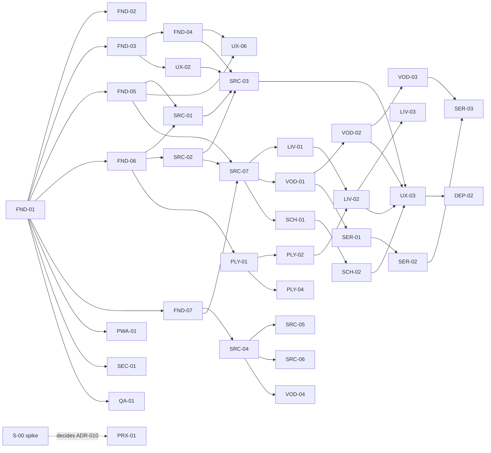

# Backlog — story status

**Single source of truth for status.** Details in `USER_STORIES.md`. Only the coordinator edits this file (see `AGENT_WORKFLOW.md`).

Allowed statuses (exactly one per story):
`Backlog` → `Ready` → `In Progress` → `In Review` → `Done` · or `Blocked` (with reason) · `Dropped` (with reason).

**Wave** column: stories in the same wave **can run in parallel** as long as their dependencies are `Done` and they do not share "serialized" files (see `AGENT_WORKFLOW.md §5`).

## MVP (v1.0) — 57 stories · 167 points

| ID | Title | Epic | Prio | Pts | Depends on | Wave | Milestone | Status |
|---|---|---|---|---|---|---|---|---|
| S-00 | Validate real provider compatibility | E0 | Must | 3 | — | 0 | M0 | In Progress |
| FND-01 | Project scaffold | E0 | Must | 3 | — | 0 | M0 | Done |
| FND-02 | CI pipeline | E0 | Must | 2 | FND-01 | 1 | M0 | Done |
| FND-03 | Tokens, theme and AppShell | E0 | Must | 5 | FND-01 | 1 | M0 | Done |
| FND-05 | Dexie persistence | E0 | Must | 5 | FND-01 | 1 | M0 | Done |
| FND-06 | Redacting logger and errors | E0 | Must | 2 | FND-01 | 1 | M0 | Done |
| FND-07 | Web Worker infra | E0 | Must | 2 | FND-01 | 1 | M0 | Done |
| PWA-01 | Manifest and installability | E10 | Must | 2 | FND-01 | 1 | M0 | Backlog |
| SEC-01 | CSP, URL validation, sanitization | E12 | Must | 3 | FND-01 | 1 | M0 | Done |
| QA-01 | Fixtures, mocks and test streams | E13 | Must | 3 | FND-01 | 1 | M0 | Done |
| FND-04 | Routing and skeleton | E0 | Must | 2 | FND-03 | 2 | M0 | Done |
| UX-02 | State components | E11 | Must | 3 | FND-03 | 2 | M0 | Done |
| SRC-01 | Credential vault | E1 | Must | 3 | FND-05, FND-06 | 2 | M1 | Done |
| SRC-02 | Xtream client: auth/account | E1 | Must | 3 | FND-06 | 2 | M1 | Done |
| SRC-04 | Streaming M3U parser | E1 | Must | 5 | FND-07 | 2 | M1 | Done |
| PLY-01 | Playback core and engine selection | E3 | Must | 5 | FND-01, FND-06 | 2 | M1 | Done |
| FAV-01 | Favorites | E9 | Must | 2 | FND-05 | 2 | M2 | Done |
| FAV-02 | History / continue watching | E9 | Must | 2 | FND-05 | 2 | M2 | Done |
| PWA-02 | Service worker and cache | E10 | Must | 3 | PWA-01 | 2 | M3 | Backlog |
| PWA-05 | Persistent storage | E10 | Must | 1 | FND-05 | 2 | M3 | Backlog |
| QA-03 | Performance budgets | E13 | Must | 2 | FND-02, FND-03 | 2 | M0 | Backlog |
| DEP-01 | GitHub Pages deploy (**approval**) | E13 | Must | 2 | FND-02, PWA-01 | 2 | M0 | Done |
| UX-01 | Onboarding | E11 | Must | 2 | FND-04 | 3 | M1 | Done |
| UX-06 | Interface language (English / Português) | E11 | Must | 2 | FND-04, FND-05 | 3 | M1 | Backlog |
| SRC-03 | Add Xtream source (UI) | E1 | Must | 3 | SRC-01, SRC-02, FND-04, UX-02 | 3 | M1 | Done |
| SRC-05 | Import M3U by URL | E1 | Must | 3 | SRC-04, SRC-01, FND-05 | 3 | M1 | Done |
| SRC-06 | Import M3U file | E1 | Must | 2 | SRC-04, FND-05 | 3 | M1 | Backlog |
| SRC-07 | Sync Xtream catalog | E1 | Must | 5 | SRC-02, FND-05, FND-07 | 3 | M1 | Done |
| VOD-04 | VOD/series classification in M3U | E5 | Must | 3 | SRC-04 | 3 | M2 | Backlog |
| PLY-02 | Player UI | E3 | Must | 5 | PLY-01, FND-03 | 3 | M1 | Done |
| PLY-04 | Playback errors | E3 | Must | 3 | PLY-01, FND-06 | 3 | M1 | Done |
| PWA-03 | Predictable updates | E10 | Must | 2 | PWA-02 | 3 | M3 | Backlog |
| PWA-04 | Offline and network errors | E10 | Must | 2 | UX-02 | 3 | M3 | Backlog |
| QA-02 | Playwright E2E + axe | E13 | Must | 3 | FND-02, QA-01 | 3 | M1 | Backlog |
| SRC-08 | "My lists" page | E1 | Must | 3 | SRC-03, SRC-05, SRC-07 | 4 | M2 | Done |
| SRC-09 | Compatibility diagnostics | E1 | Must | 3 | SRC-02, PLY-01 | 4 | M1 | Backlog |
| SRC-10 | Delete all data | E1 | Must | 2 | FND-05, SRC-01, PWA-02 | 4 | M3 | Backlog |
| LIV-01 | Categories and channel list | E4 | Must | 5 | FND-04, FND-05, UX-02, SRC-07 | 4 | M1 | Done |
| VOD-01 | Movie grid | E5 | Must | 3 | FND-04, FND-05, UX-02, SRC-07 | 4 | M2 | Done |
| PLY-03 | Fullscreen and PiP | E3 | Must | 3 | PLY-02 | 4 | M1 | Done |
| SCH-01 | Search index | E8 | Must | 3 | FND-07, SRC-07 | 4 | M2 | In Progress |
| LIV-02 | Play channel and zapping | E4 | Must | 5 | LIV-01, PLY-02 | 5 | M1 | Done |
| LIV-04 | Quick channel filter | E4 | Must | 2 | LIV-01 | 5 | M1 | Done |
| VOD-02 | Movie details | E5 | Must | 3 | VOD-01, PLY-02 | 5 | M2 | Done |
| SER-01 | Series grid | E6 | Must | 2 | VOD-01 | 5 | M2 | In Progress |
| EPG-01 | Xtream now/next | E7 | Must | 3 | LIV-01, SRC-02 | 5 | M2 | Done |
| SCH-02 | Global search | E8 | Must | 3 | SCH-01, FND-04 | 5 | M2 | In Progress |
| UX-04 | Settings and privacy | E11 | Must | 2 | FND-04, SRC-08 | 5 | M3 | Backlog |
| LIV-03 | Remember last channel | E4 | Must | 2 | LIV-02, FND-05 | 6 | M1 | Done |
| VOD-03 | VOD with resume | E5 | Must | 3 | VOD-02, FAV-02 | 6 | M2 | In Progress |
| SER-02 | Series details | E6 | Must | 5 | SER-01, PLY-02 | 6 | M2 | In Progress |
| SER-03 | Episode, resume, next | E6 | Must | 3 | SER-02, VOD-03 | 7 | M2 | In Progress |
| FAV-03 | Home and Favorites | E9 | Must | 3 | FAV-01, FAV-02, LIV-02, VOD-01, SER-01 | 7 | M2 | Done |
| UX-03 | Keyboard and a11y audit | E11 | Must | 3 | LIV-02, VOD-02, SCH-02, SRC-03 | 7 | M3 | Backlog |
| DEP-02 | Manual validation on devices | E13 | Must | 3 | Release candidate | 8 | M3 | Backlog |
| TEC-01 | Load feature strings with their feature | E15 | Must | 3 | — | 5 | M2 | Done |
| LIV-05 | Live player integration follow-ups | E4 | Must | 2 | PLY-03, PLY-04, LIV-03 | 6 | M1 | Done |

## Post-MVP

| ID | Title | Prio | Pts | Depends on | Status |
|---|---|---|---|---|---|
| PRX-01 | Self-hosted proxy (may move up to Must — ADR-010) | Could | 5 | PLY-01, SRC-02 | Backlog |
| EPG-02 | Import XMLTV | Should | 5 | FND-07, FND-05 | Backlog |
| EPG-03 | Channel↔EPG matching | Should | 3 | EPG-02, LIV-01 | Backlog |
| PLY-05 | Audio tracks and subtitles | Should | 3 | PLY-02 | Backlog |
| SEC-02 | Master password | Should | 5 | SRC-01 | Backlog |
| EXP-01 | Export/import settings | Should | 3 | SRC-08, FAV-03 | Backlog |
| UX-05 | D-pad navigation | Should | 5 | UX-03 | Backlog |
| MSS-01 | Media Session | Should | 1 | PLY-02 | Backlog |
| TEC-02 | Extract shared feature helpers into `src/ui` | Should | 3 | VOD-01, LIV-03 | Done |
| SEC-03 | Parental control PIN | Could | 3 | LIV-01, VOD-01 | Backlog |
| EPG-04 | EPG grid | Could | 8 | EPG-03 | Backlog |
| PRF-01 | Multiple profiles | Could | 5 | FAV-03 | Backlog |
| CST-01 | Remote Playback / Cast | Could | 5 | PLY-02 | Backlog |
| NAT-01 | Capacitor Android shell | Could | 8 | MVP | Backlog |

## Dependency graph (MVP)

**Critical path:** FND-01 → FND-05 → SRC-07 → VOD-01 → VOD-02 → VOD-03 → SER-03 → (RC) → DEP-02.
**Priority vertical slice (M1 "First channel"):** FND-01 → FND-03/05/06/07 → SRC-01/02 → SRC-03/07 → PLY-01/02 → LIV-01 → LIV-02. Must be completed before investing in VOD/series, to validate real playback early.

## Impediments log
| Date | Story | Impediment | Action | Status |
|---|---|---|---|---|
| — | — | — | — | — |
