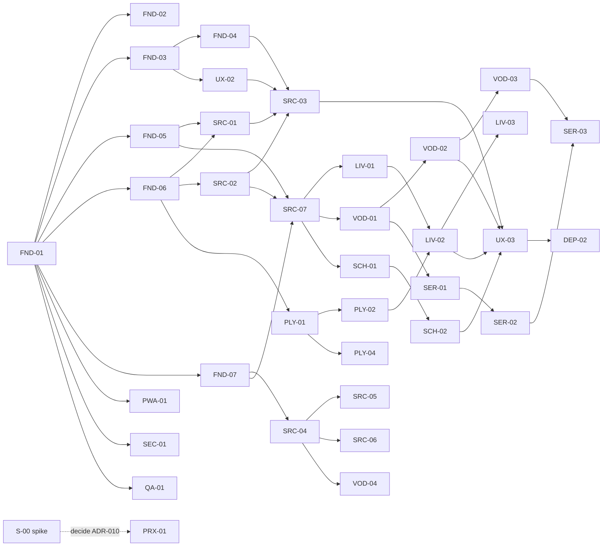

# Backlog — estado das stories

**Fonte única de verdade para o estado.** Detalhes em `USER_STORIES.md`. Só o coordenador altera este ficheiro (ver `AGENT_WORKFLOW.md`).

Estados permitidos (exatamente um por story):
`Backlog` → `Ready` → `In Progress` → `In Review` → `Done` · ou `Blocked` (com motivo) · `Dropped` (com motivo).

Coluna **Onda**: stories da mesma onda **podem correr em paralelo** desde que as suas dependências estejam `Done` e não partilhem ficheiros "serializados" (ver `AGENT_WORKFLOW.md §5`).

## MVP (v1.0) — 54 stories · 160 pontos

| ID | Título | Épico | Prio | Pts | Depende de | Onda | Marco | Estado |
|---|---|---|---|---|---|---|---|---|
| S-00 | Validar compatibilidade do fornecedor real | E0 | Must | 3 | — | 0 | M0 | In Progress |
| FND-01 | Scaffold do projeto | E0 | Must | 3 | — | 0 | M0 | Done |
| FND-02 | Pipeline de CI | E0 | Must | 2 | FND-01 | 1 | M0 | Backlog |
| FND-03 | Tokens, tema e AppShell | E0 | Must | 5 | FND-01 | 1 | M0 | Backlog |
| FND-05 | Persistência Dexie | E0 | Must | 5 | FND-01 | 1 | M0 | Backlog |
| FND-06 | Logger com redação e erros | E0 | Must | 2 | FND-01 | 1 | M0 | Backlog |
| FND-07 | Infra Web Worker | E0 | Must | 2 | FND-01 | 1 | M0 | Backlog |
| PWA-01 | Manifesto e instalabilidade | E10 | Must | 2 | FND-01 | 1 | M0 | Backlog |
| SEC-01 | CSP, validação de URLs, sanitização | E12 | Must | 3 | FND-01 | 1 | M0 | Backlog |
| QA-01 | Fixtures, mocks e streams de teste | E13 | Must | 3 | FND-01 | 1 | M0 | Backlog |
| FND-04 | Routing e esqueleto | E0 | Must | 2 | FND-03 | 2 | M0 | Backlog |
| UX-02 | Componentes de estado | E11 | Must | 3 | FND-03 | 2 | M0 | Backlog |
| SRC-01 | Cofre de credenciais | E1 | Must | 3 | FND-05, FND-06 | 2 | M1 | Backlog |
| SRC-02 | Cliente Xtream: auth/conta | E1 | Must | 3 | FND-06 | 2 | M1 | Backlog |
| SRC-04 | Parser M3U streaming | E1 | Must | 5 | FND-07 | 2 | M1 | Backlog |
| PLY-01 | Motor e seleção de engine | E3 | Must | 5 | FND-01, FND-06 | 2 | M1 | Backlog |
| FAV-01 | Favoritos | E9 | Must | 2 | FND-05 | 2 | M2 | Backlog |
| FAV-02 | Histórico / continuar a ver | E9 | Must | 2 | FND-05 | 2 | M2 | Backlog |
| PWA-02 | Service worker e cache | E10 | Must | 3 | PWA-01 | 2 | M3 | Backlog |
| PWA-05 | Armazenamento persistente | E10 | Must | 1 | FND-05 | 2 | M3 | Backlog |
| QA-03 | Orçamentos de desempenho | E13 | Must | 2 | FND-02, FND-03 | 2 | M0 | Backlog |
| DEP-01 | Deploy GitHub Pages (**aprovação**) | E13 | Must | 2 | FND-02, PWA-01 | 2 | M0 | Backlog |
| UX-01 | Onboarding | E11 | Must | 2 | FND-04 | 3 | M1 | Backlog |
| SRC-03 | Adicionar fonte Xtream (UI) | E1 | Must | 3 | SRC-01, SRC-02, FND-04, UX-02 | 3 | M1 | Backlog |
| SRC-05 | Importar M3U por URL | E1 | Must | 3 | SRC-04, SRC-01, FND-05 | 3 | M1 | Backlog |
| SRC-06 | Importar ficheiro M3U | E1 | Must | 2 | SRC-04, FND-05 | 3 | M1 | Backlog |
| SRC-07 | Sincronizar catálogo Xtream | E1 | Must | 5 | SRC-02, FND-05, FND-07 | 3 | M1 | Backlog |
| VOD-04 | Classificação VOD/séries em M3U | E5 | Must | 3 | SRC-04 | 3 | M2 | Backlog |
| PLY-02 | UI do leitor | E3 | Must | 5 | PLY-01, FND-03 | 3 | M1 | Backlog |
| PLY-04 | Erros de reprodução | E3 | Must | 3 | PLY-01, FND-06 | 3 | M1 | Backlog |
| PWA-03 | Atualizações previsíveis | E10 | Must | 2 | PWA-02 | 3 | M3 | Backlog |
| PWA-04 | Offline e erros de rede | E10 | Must | 2 | UX-02 | 3 | M3 | Backlog |
| QA-02 | E2E Playwright + axe | E13 | Must | 3 | FND-02, QA-01 | 3 | M1 | Backlog |
| SRC-08 | Página "As minhas listas" | E1 | Must | 3 | SRC-03, SRC-05, SRC-07 | 4 | M2 | Backlog |
| SRC-09 | Diagnóstico de compatibilidade | E1 | Must | 3 | SRC-02, PLY-01 | 4 | M1 | Backlog |
| SRC-10 | Apagar todos os dados | E1 | Must | 2 | FND-05, SRC-01, PWA-02 | 4 | M3 | Backlog |
| LIV-01 | Categorias e lista de canais | E4 | Must | 5 | FND-04, FND-05, UX-02, SRC-07 | 4 | M1 | Backlog |
| VOD-01 | Grelha de filmes | E5 | Must | 3 | FND-04, FND-05, UX-02, SRC-07 | 4 | M2 | Backlog |
| PLY-03 | Ecrã inteiro e PiP | E3 | Must | 3 | PLY-02 | 4 | M1 | Backlog |
| SCH-01 | Índice de pesquisa | E8 | Must | 3 | FND-07, SRC-07 | 4 | M2 | Backlog |
| LIV-02 | Reproduzir canal e zapping | E4 | Must | 5 | LIV-01, PLY-02 | 5 | M1 | Backlog |
| LIV-04 | Filtro rápido de canais | E4 | Must | 2 | LIV-01 | 5 | M1 | Backlog |
| VOD-02 | Detalhe do filme | E5 | Must | 3 | VOD-01, PLY-02 | 5 | M2 | Backlog |
| SER-01 | Grelha de séries | E6 | Must | 2 | VOD-01 | 5 | M2 | Backlog |
| EPG-01 | Agora/seguinte Xtream | E7 | Must | 3 | LIV-01, SRC-02 | 5 | M2 | Backlog |
| SCH-02 | Pesquisa global | E8 | Must | 3 | SCH-01, FND-04 | 5 | M2 | Backlog |
| UX-04 | Definições e privacidade | E11 | Must | 2 | FND-04, SRC-08 | 5 | M3 | Backlog |
| LIV-03 | Lembrar último canal | E4 | Must | 2 | LIV-02, FND-05 | 6 | M1 | Backlog |
| VOD-03 | VOD com retomar | E5 | Must | 3 | VOD-02, FAV-02 | 6 | M2 | Backlog |
| SER-02 | Detalhe da série | E6 | Must | 5 | SER-01, PLY-02 | 6 | M2 | Backlog |
| SER-03 | Episódio, retomar, próximo | E6 | Must | 3 | SER-02, VOD-03 | 7 | M2 | Backlog |
| FAV-03 | Início e Favoritos | E9 | Must | 3 | FAV-01, FAV-02, LIV-02, VOD-01, SER-01 | 7 | M2 | Backlog |
| UX-03 | Teclado e auditoria a11y | E11 | Must | 3 | LIV-02, VOD-02, SCH-02, SRC-03 | 7 | M3 | Backlog |
| DEP-02 | Validação manual em dispositivos | E13 | Must | 3 | Release candidate | 8 | M3 | Backlog |

## Pós-MVP

| ID | Título | Prio | Pts | Depende de | Estado |
|---|---|---|---|---|---|
| PRX-01 | Proxy self-hosted (pode subir a Must — ADR-010) | Could | 5 | PLY-01, SRC-02 | Backlog |
| EPG-02 | Importar XMLTV | Should | 5 | FND-07, FND-05 | Backlog |
| EPG-03 | Correspondência canal↔EPG | Should | 3 | EPG-02, LIV-01 | Backlog |
| PLY-05 | Faixas de áudio e legendas | Should | 3 | PLY-02 | Backlog |
| SEC-02 | Palavra-passe mestra | Should | 5 | SRC-01 | Backlog |
| EXP-01 | Exportar/importar configurações | Should | 3 | SRC-08, FAV-03 | Backlog |
| UX-05 | Navegação D-pad | Should | 5 | UX-03 | Backlog |
| MSS-01 | Media Session | Should | 1 | PLY-02 | Backlog |
| SEC-03 | Controlo parental PIN | Could | 3 | LIV-01, VOD-01 | Backlog |
| EPG-04 | Grelha EPG | Could | 8 | EPG-03 | Backlog |
| PRF-01 | Perfis múltiplos | Could | 5 | FAV-03 | Backlog |
| CST-01 | Remote Playback / Cast | Could | 5 | PLY-02 | Backlog |
| NAT-01 | Shell Android Capacitor | Could | 8 | MVP | Backlog |

## Grafo de dependências (MVP)

**Caminho crítico:** FND-01 → FND-05 → SRC-07 → VOD-01 → VOD-02 → VOD-03 → SER-03 → (RC) → DEP-02.
**Fatia vertical prioritária (M1 "Primeiro canal"):** FND-01 → FND-03/05/06/07 → SRC-01/02 → SRC-03/07 → PLY-01/02 → LIV-01 → LIV-02. Deve ser concluída antes de investir em VOD/séries, para validar a reprodução real cedo.

## Registo de impedimentos
| Data | Story | Impedimento | Ação | Estado |
|---|---|---|---|---|
| — | — | — | — | — |
