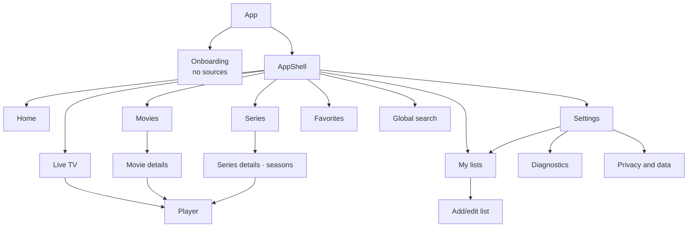
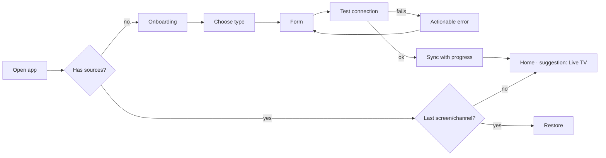
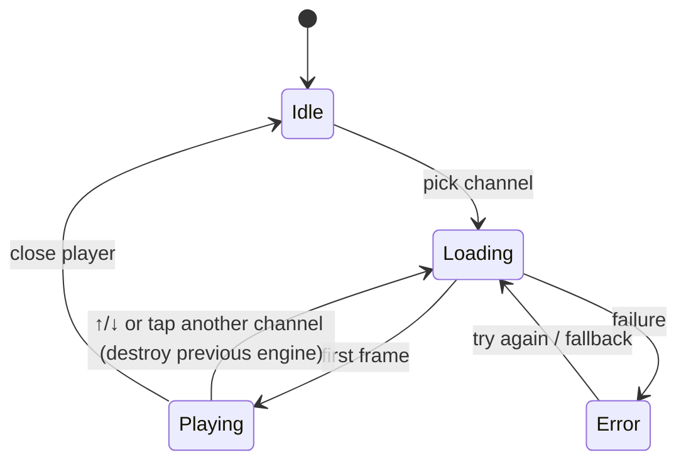

# UX/UI and visual system

## 1. Visual direction — "Dark room"
Inspired by the usability patterns of IPTV players (section-based navigation, channel list next to the video, fast zapping), **without** reusing the identity, gradients, icons or exclusive layouts of any existing app.

Principles:
1. **Content is the color.** Neutral, dark interface; posters and logos provide the color.
2. **Two taps to video.** Open app → last channel or "Continue watching" in 1 tap.
3. **Less chrome.** No heavy shadows, no gradients, no *ripple*; hierarchy through tonal surfaces and typography.
4. **Immediate feedback.** Every action responds in < 100 ms (visual state), even if the network takes longer.
5. **Honesty.** Errors say what happened and what to do.

## 2. Tokens

### 2.1 Color
| Token | Dark (default) | Light | Use |
|---|---|---|---|
| `bg` | `#0B0E13` | `#F6F7F9` | App background |
| `surface-1` | `#12161D` | `#FFFFFF` | Cards, lists |
| `surface-2` | `#1A2029` | `#EEF1F4` | Bars, elevated panels |
| `surface-3` | `#232B36` | `#E2E6EB` | Hover/selected |
| `outline` | `#2E3845` | `#CBD2DA` | Dividers, secondary focus borders |
| `text` | `#E8ECF1` | `#11151B` | Primary text |
| `text-muted` | `#9AA6B4` | `#56606C` | Metadata |
| `accent` | `#3DDCB0` (mint) | `#087258` | Primary action, selection, focus |
| `on-accent` | `#04130E` | `#FFFFFF` | Text on accent |
| `live` | `#FF5A5F` | `#BF2A2F` | "Live" indicator, EPG progress |
| `warning` | `#F5B544` | `#8A5A00` | Account expiring, warnings |
| `danger` | `#FF6B6B` | `#BE2626` | Errors, destructive actions |
| `focus-ring` | `#3DDCB0` 2 px + 2 px offset | `#087258` | Keyboard focus (always visible) |

Text/background pairs must meet ≥ 4.5:1 (normal text) and ≥ 3:1 (UI/icons) — **automated validation mandatory in FND-03** (validated by `src/ui/theme/contrast.test.ts`; light-theme accent, live, warning and danger were darkened in FND-03 to pass on all surfaces).

### 2.2 Typography
- **Inter Variable** self-hosted (`@fontsource-variable/inter`, OFL) — no Google Fonts (privacy). Fallback: `system-ui, -apple-system, "Segoe UI", Roboto, sans-serif`.
- Scale (rem, base 16): `display 2.0/700` · `title 1.375/650` · `heading 1.125/600` · `body 1.0/400` · `body-sm 0.875/400` · `caption 0.75/500` (uppercase with +0.04em tracking only on labels).
- EPG times and channel numbers with `font-variant-numeric: tabular-nums`.
- **i18n (ADR-015):** the UI ships in English (base) and pt-PT. pt-PT strings are often ~20–30% longer than English — layouts must not truncate them: buttons, chips, tabs, navigation labels and dialogs must wrap or grow instead of clipping (ellipsis only for user/provider content such as channel or movie names). Review every screen in both locales.

### 2.3 Spacing, shape and motion
- 4 px grid: `4, 8, 12, 16, 24, 32, 48, 64`. Page margins: 16 (mobile) / 24 (tablet) / 32 (desktop).
- Radii: `8` (chips, inputs), `12` (cards), `16` (sheets/dialogs), `999` (pills).
- Touch targets ≥ 44×44 px.
- Motion: 120–200 ms, `cubic-bezier(.2,0,0,1)`; respect `prefers-reduced-motion` (no transition animations).

### 2.4 Iconography
Material Symbols Rounded (Apache-2.0) via `@mui/icons-material` with individual imports, or Lucide (ISC). Own app icon: simple shape (rounded screen + wave/signal) in mint on `bg`.

## 3. Navigation and hierarchy



| Viewport | Main navigation | Notes |
|---|---|---|
| Mobile (< 600 px) | Bottom bar: Home · Live · Movies · Series · Favorites | Search and source selector in the top bar; Settings in the avatar/menu |
| Tablet (600–1199 px) | Side *navigation rail* (icon + label) | Live in 2 panes |
| Desktop (≥ 1200 px) | Expanded rail | Live in 3 panes |

**Home** = "Continue watching" (movies/episodes with progress) · "Recent channels" · "Favorites". If empty: shortcuts to Live/Movies/Series. There are no "promotional carousels".

**List selector**: menu in the top bar with the name of the active list; instant switch (data already in IndexedDB). The last menu option is "Manage lists…", which opens the **My lists** page.

## 4. Descriptive wireframes

### 4.1 Onboarding (no sources)
```
┌──────────────────────────────┐
│          [logo]              │
│  Welcome to Simple IPTV      │
│ Connect your IPTV            │
│ subscription.                │
│ We don't include channels.   │
│                              │
│ ┌──────────────────────────┐ │
│ │ ◉ Xtream Codes (recomm.) │ │
│ │   server + username      │ │
│ └──────────────────────────┘ │
│ ┌──────────────────────────┐ │
│ │ ○ M3U list (URL)         │ │
│ └──────────────────────────┘ │
│ ┌──────────────────────────┐ │
│ │ ○ Local M3U file         │ │
│ └──────────────────────────┘ │
│  Your data stays on this     │
│  device only. [Learn more]   │
└──────────────────────────────┘
```

### 4.1b My lists
Reachable from the list selector (top bar), from Settings and, on desktop, from the rail.
```
┌──────────────────────────────┐
│ ← My lists             [+ Add]
├──────────────────────────────┤
│ ● Living room         ACTIVE │
│   Xtream · 1 234 channels · 8 900 movies · 410 series
│   Updated 2 h ago · Account valid until 12/2026
│   [Refresh] [Edit] [⋮]       │
├──────────────────────────────┤
│ ○ Sports list                │
│   M3U (URL) · 312 channels   │
│   Updated yesterday          │
│   [Use this] [Refresh] [⋮]   │
├──────────────────────────────┤
│ ○ Laptop list                │
│   M3U (file) · 95 channels   │
│   ⚠ HTTP-only server — see diagnostics
│   [Use this] [⋮]             │
└──────────────────────────────┘
⋮ = Rename · Diagnostics · Remove
```
States: no lists → onboarding; syncing → progress bar on the card; error → warning on the card with an action.

### 4.2 Xtream form
```
Name (optional)       [ Living room          ]
Server                [ http://example:8080  ]  ← accepts with/without http(s), port, trailing slash
Username              [                      ]
Password              [ ••••••••        (👁) ]
                      [   Test and save      ]
── Test result ────────────────────────────────
✔ Valid credentials · account active until 12/2026
⚠ HTTP-only server → may not play in the browser  [What can I do?]
```
Test in visible steps: *Contacting server → Validating account → Loading channels (1 234) → Movies → Series → Search index*. Cancelable.

### 4.3 Live TV — mobile (portrait)
```
┌──────────────────────────────┐
│ ▣ Home ▾            🔍   ⋮   │
├──────────────────────────────┤
│ ┌──────────────────────────┐ │  ← 16:9 player pinned at the top (only while playing)
│ │         VIDEO            │ │
│ │ ● LIVE    RTP 1  ⤢  ⧉    │ │
│ └──────────────────────────┘ │
│ Now 20:00 Telejornal ▓▓▓░░   │
│ Next 21:00 Series X          │
├──────────────────────────────┤
│ [★ Favorites][All][News][Sports] → scrollable chips
│ [ Filter channels…         ] │
│ 001 [logo] RTP 1        ★    │
│ 002 [logo] RTP 2             │  ← 64 px row, virtualized
│ 003 [AB]   No-logo channel   │  ← fallback: initials
├──────────────────────────────┤
│ ⌂   📺   🎬   🎞   ★          │
└──────────────────────────────┘
```
Rotate to landscape → automatic fullscreen (configurable). Vertical swipe on the video in fullscreen → previous/next channel (desktop: ↑/↓, PageUp/PageDown, numbers).

### 4.4 Live TV — desktop
```
┌────┬───────────────┬──────────────────────────────────────┐
│ ⌂  │ Categories    │ ┌──────────────────────────────────┐ │
│ 📺 │ ★ Favorites   │ │                                  │ │
│ 🎬 │ Recent        │ │              VIDEO               │ │
│ 🎞 │ All (1 234)   │ │                                  │ │
│ ★  │ News          │ └──────────────────────────────────┘ │
│    │ Sports    ◀── │ RTP 1 · ● Live                       │
│    ├───────────────┤ Now   20:00–21:00 Telejornal ▓▓▓░   │
│    │ Filter…       │ Next  21:00–22:00 Series X           │
│ ⚙  │ 001 RTP 1  ★  │                                      │
│    │ 002 RTP 2     │                                      │
└────┴───────────────┴──────────────────────────────────────┘
```

### 4.5 Player — controls overlay
- Tap/mouse movement shows the controls; they hide after 3 s without interaction (never while keyboard focus is on the controls).
- Top: ← back · name · *Live* indicator / time.
- Center: play/pause (large), ⏮/⏭ channel (live) or −10 s/+10 s (VOD).
- Bottom: progress bar (VOD) or EPG progress (live) · volume · PiP · tracks (post-MVP) · fullscreen.
- "Channels" side panel (live) overlaid in fullscreen, opened by a button or the `L` key.
- Shortcuts: `Space`/`K` play, `F` fullscreen, `M` mute, `←/→` ±10 s, `↑/↓` channel, `L` list, `Esc` exit.

### 4.6 Cards
| Card | Size | Content | States |
|---|---|---|---|
| Channel (row) | 64 px height | number · 40×40 logo · name · now (1 line, muted) · ★ | normal, focus, playing (accent bar on the left), favorite |
| Movie (poster) | 2:3, width 112/144/168 px | poster · title (2 lines) · year | no poster → tonal block + title; "continue" progress as a 3 px bar |
| Series (poster) | 2:3 | poster · title · number of seasons | same |
| Episode (row) | 72 px | optional 16:9 thumbnail · "E03 · Title" · duration · progress | watched (✓), in progress |

### 4.7 Movie/series details
Blurred backdrop/poster at the top (≤ 40 % of the height) · title · year · duration · rating · genre · **Play/Resume** (primary) and **★** buttons · synopsis (3 lines + "more"). Series: season selector (tabs, or a dropdown if > 6) and episode list.

### 4.8 Settings
Sections (list → pages on mobile, master/detail on tablet/desktop):
- **My lists** — opens the My lists page (4.1b).
- **Appearance** — Theme: System / Dark / Light.
- **Language** — System / English / Português (ADR-015, story UX-06). "System" follows the browser language (`pt*` → pt-PT, otherwise English). The change applies immediately, without a reload, and updates `<html lang>`. Language names are always shown in their own language.
- **Diagnostics** — connection tests and Diagnostics report.
- **Privacy and data** — what is stored on the device, Delete all data.

```
┌──────────────────────────────┐
│ ← Settings                   │
├──────────────────────────────┤
│ My lists                   › │
│ Appearance        Dark     › │
│ Language          System   › │
│ Diagnostics                › │
│ Privacy and data           › │
└──────────────────────────────┘
  Language
  ◉ System (English)
  ○ English
  ○ Português
```

## 5. System states (`StateView` components)
| State | Pattern | Example text |
|---|---|---|
| Short loading (< 300 ms) | Nothing (avoid flashing) | — |
| Loading | Skeletons shaped like the content | — |
| Long sync | Bar with step and count, cancelable | "Loading movies… 12 400" |
| Empty (no sources) | Simple illustration + CTA | "You don't have any sources yet. Add source" |
| Empty (category) | Text + action | "This category is empty." |
| No results | Suggestion | "No results for 'xyz'. Try another term." |
| Recoverable error | Message + "Try again" + "Details" | "Couldn't reach the server (timed out)." |
| Offline | Persistent banner at the top | "No connection. You can browse, but not play." |
| Playback error | Overlay on the video + actions | "This channel uses Dolby audio, which this browser doesn't support. Try Safari or HLS mode." |

## 6. Flows

### 6.1 First use


### 6.2 Zapping


## 7. Accessibility
- WCAG 2.2 AA: contrast, visible focus, targets ≥ 24 px (internal target 44 px), no reliance on color alone (★ + "Favorite" label).
- Virtualized lists with `role="listbox"`/`aria-activedescendant` or `role="list"` + roving tabindex; `aria-setsize`/`aria-posinset`.
- Player: buttons with `aria-label`; `aria-live="polite"` announcements on channel change ("Watching RTP 1").
- Full keyboard navigation: `Tab` between regions, arrows inside lists/grids, `/` focuses search.
- Respect `prefers-reduced-motion`, `prefers-color-scheme` ("System" option), zoom up to 200 % without loss.
- `<html lang>` always matches the active locale (en / pt-PT) so screen readers use the right pronunciation.

## 8. Responsive behavior (summary)
| Screen | Mobile | Tablet | Desktop |
|---|---|---|---|
| Live | Video on top + list | List \| video | Categories \| list \| video+EPG |
| Movies/Series | 3-col grid | 4–6 col. | 6–8 col. + side filters |
| Details | Page | 2-column page | Large dialog or 2-column page |
| Settings | List → pages | Master/detail | Master/detail |
| My lists | Stacked cards | Cards in 2 columns | Cards in a grid + side detail |
