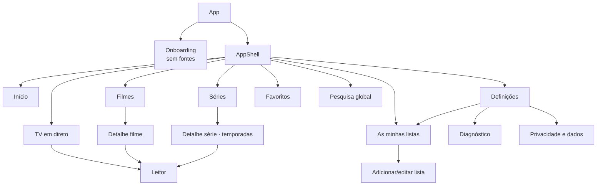
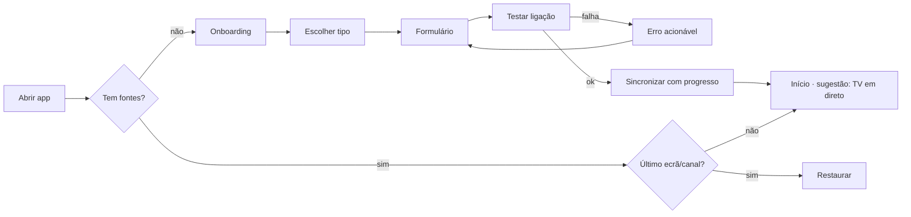
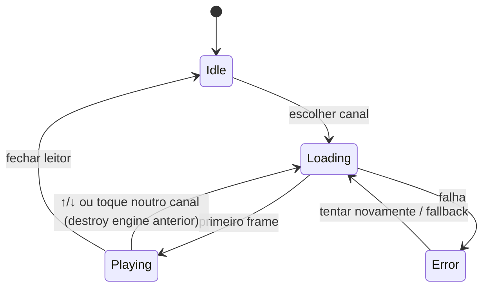

# UX/UI e sistema visual

## 1. Direção visual — "Sala escura"
Inspiração nos padrões de usabilidade dos leitores IPTV (navegação por secções, lista de canais ao lado do vídeo, zapping rápido), **sem** reutilizar a identidade, gradientes, ícones ou layouts exclusivos de qualquer app existente.

Princípios:
1. **O conteúdo é a cor.** Interface neutra e escura; os posters e logos dão cor.
2. **Dois toques até ao vídeo.** Abrir app → último canal ou "continuar a ver" em 1 toque.
3. **Menos cromado.** Sem sombras pesadas, sem gradientes, sem *ripple*; hierarquia por superfícies tonais e tipografia.
4. **Feedback imediato.** Toda a ação responde em < 100 ms (estado visual), mesmo que a rede demore.
5. **Honestidade.** Erros dizem o que aconteceu e o que fazer.

## 2. Tokens

### 2.1 Cor
| Token | Escuro (padrão) | Claro | Uso |
|---|---|---|---|
| `bg` | `#0B0E13` | `#F6F7F9` | Fundo da app |
| `surface-1` | `#12161D` | `#FFFFFF` | Cartões, listas |
| `surface-2` | `#1A2029` | `#EEF1F4` | Barras, painéis elevados |
| `surface-3` | `#232B36` | `#E2E6EB` | Hover/selecionado |
| `outline` | `#2E3845` | `#CBD2DA` | Divisores, bordas de foco secundárias |
| `text` | `#E8ECF1` | `#11151B` | Texto principal |
| `text-muted` | `#9AA6B4` | `#56606C` | Metadados |
| `accent` | `#3DDCB0` (menta) | `#0A7A5E` | Ação primária, seleção, foco |
| `on-accent` | `#04130E` | `#FFFFFF` | Texto sobre accent |
| `live` | `#FF5A5F` | `#D62F35` | Indicador "Em direto", progresso EPG |
| `warning` | `#F5B544` | `#9A6400` | Conta a expirar, avisos |
| `danger` | `#FF6B6B` | `#C62828` | Erros, ações destrutivas |
| `focus-ring` | `#3DDCB0` 2 px + offset 2 px | `#0A7A5E` | Foco de teclado (sempre visível) |

Os pares texto/fundo têm de cumprir ≥ 4,5:1 (texto normal) e ≥ 3:1 (UI/ícones) — **validação automática obrigatória em FND-03** (os valores acima são ponto de partida, não estão medidos).

### 2.2 Tipografia
- **Inter Variable** auto-alojada (`@fontsource-variable/inter`, OFL) — sem Google Fonts (privacidade). Fallback: `system-ui, -apple-system, "Segoe UI", Roboto, sans-serif`.
- Escala (rem, base 16): `display 2.0/700` · `title 1.375/650` · `heading 1.125/600` · `body 1.0/400` · `body-sm 0.875/400` · `caption 0.75/500` (maiúsculas com tracking +0.04em só em rótulos).
- Horas do EPG e números de canal com `font-variant-numeric: tabular-nums`.

### 2.3 Espaçamento, forma e movimento
- Grelha de 4 px: `4, 8, 12, 16, 24, 32, 48, 64`. Margens de página: 16 (mobile) / 24 (tablet) / 32 (desktop).
- Raios: `8` (chips, inputs), `12` (cartões), `16` (sheets/dialogs), `999` (pills).
- Alvos de toque ≥ 44×44 px.
- Movimento: 120–200 ms, `cubic-bezier(.2,0,0,1)`; respeitar `prefers-reduced-motion` (sem animações de transição).

### 2.4 Iconografia
Material Symbols Rounded (Apache-2.0) via `@mui/icons-material` com imports individuais, ou Lucide (ISC). Ícone da app próprio: forma simples (ecrã arredondado + onda/sinal) em menta sobre `bg`.

## 3. Navegação e hierarquia



| Viewport | Navegação principal | Notas |
|---|---|---|
| Mobile (< 600 px) | Barra inferior: Início · Direto · Filmes · Séries · Favoritos | Pesquisa e seletor de fonte na barra superior; Definições no avatar/menu |
| Tablet (600–1199 px) | *Navigation rail* lateral (ícone + rótulo) | Live em 2 painéis |
| Desktop (≥ 1200 px) | Rail expandido | Live em 3 painéis |

**Início** = "Continuar a ver" (filmes/episódios com progresso) · "Canais recentes" · "Favoritos". Se vazio: atalhos para Direto/Filmes/Séries. Não há "carrosséis promocionais".

**Seletor de lista**: menu na barra superior com o nome da lista ativa; troca instantânea (dados já em IndexedDB). A última opção do menu é "Gerir listas…", que abre a página **As minhas listas**.

## 4. Wireframes descritivos

### 4.1 Onboarding (sem fontes)
```
┌──────────────────────────────┐
│          [logo]              │
│   Bem-vindo ao Simple IPTV   │
│ Liga a tua subscrição IPTV.  │
│ Não incluímos canais.        │
│                              │
│ ┌──────────────────────────┐ │
│ │ ◉ Xtream Codes (recom.)  │ │
│ │   servidor + utilizador  │ │
│ └──────────────────────────┘ │
│ ┌──────────────────────────┐ │
│ │ ○ Lista M3U (URL)        │ │
│ └──────────────────────────┘ │
│ ┌──────────────────────────┐ │
│ │ ○ Ficheiro M3U local     │ │
│ └──────────────────────────┘ │
│  Os teus dados ficam só      │
│  neste dispositivo. [Saber +]│
└──────────────────────────────┘
```

### 4.1b As minhas listas
Acessível pelo seletor de lista (barra superior), por Definições e, em desktop, pelo rail.
```
┌──────────────────────────────┐
│ ← As minhas listas     [+ Adicionar]
├──────────────────────────────┤
│ ● Casa                 ATIVA │
│   Xtream · 1 234 canais · 8 900 filmes · 410 séries
│   Atualizada há 2 h · Conta válida até 12/2026
│   [Atualizar] [Editar] [⋮]   │
├──────────────────────────────┤
│ ○ Lista desporto             │
│   M3U (URL) · 312 canais     │
│   Atualizada ontem           │
│   [Usar esta] [Atualizar] [⋮]│
├──────────────────────────────┤
│ ○ Lista do portátil          │
│   M3U (ficheiro) · 95 canais │
│   ⚠ Servidor só HTTP — ver diagnóstico
│   [Usar esta] [⋮]            │
└──────────────────────────────┘
⋮ = Renomear · Diagnóstico · Remover
```
Estados: sem listas → onboarding; a sincronizar → barra de progresso no cartão; erro → aviso no cartão com ação.

### 4.2 Formulário Xtream
```
Nome (opcional)       [ Casa                 ]
Servidor              [ http://exemplo:8080  ]  ← aceita com/sem http(s), porta, barra final
Utilizador            [                      ]
Palavra-passe         [ ••••••••        (👁) ]
                      [   Testar e guardar   ]
── Resultado do teste ─────────────────────────
✔ Credenciais válidas · conta ativa até 12/2026
⚠ Servidor só HTTP → pode não reproduzir no browser  [O que fazer?]
```
Teste em etapas visíveis: *A contactar servidor → A validar conta → A carregar canais (1 234) → Filmes → Séries → Índice de pesquisa*. Cancelável.

### 4.3 TV em direto — mobile (retrato)
```
┌──────────────────────────────┐
│ ▣ Casa ▾            🔍   ⋮   │
├──────────────────────────────┤
│ ┌──────────────────────────┐ │  ← leitor 16:9 fixo no topo (só quando a reproduzir)
│ │         VÍDEO            │ │
│ │ ● DIRETO  RTP 1  ⤢  ⧉    │ │
│ └──────────────────────────┘ │
│ Agora 20:00 Telejornal ▓▓▓░░ │
│ Depois 21:00 Série X         │
├──────────────────────────────┤
│ [★ Favoritos][Todos][Notícias][Desporto] → chips com scroll
│ [ Filtrar canais…          ] │
│ 001 [logo] RTP 1        ★    │
│ 002 [logo] RTP 2             │  ← linha 64 px, virtualizada
│ 003 [AB]   Canal sem logo    │  ← fallback: iniciais
├──────────────────────────────┤
│ ⌂   📺   🎬   🎞   ★          │
└──────────────────────────────┘
```
Rodar para paisagem → ecrã inteiro automático (configurável). Swipe vertical no vídeo em ecrã inteiro → canal anterior/seguinte (desktop: ↑/↓, PageUp/PageDown, números).

### 4.4 TV em direto — desktop
```
┌────┬───────────────┬──────────────────────────────────────┐
│ ⌂  │ Categorias    │ ┌──────────────────────────────────┐ │
│ 📺 │ ★ Favoritos   │ │                                  │ │
│ 🎬 │ Recentes      │ │              VÍDEO               │ │
│ 🎞 │ Todos (1 234) │ │                                  │ │
│ ★  │ Notícias      │ └──────────────────────────────────┘ │
│    │ Desporto  ◀── │ RTP 1 · ● Direto                     │
│    ├───────────────┤ Agora  20:00–21:00 Telejornal ▓▓▓░  │
│    │ Filtrar…      │ Depois 21:00–22:00 Série X           │
│ ⚙  │ 001 RTP 1  ★  │                                      │
│    │ 002 RTP 2     │                                      │
└────┴───────────────┴──────────────────────────────────────┘
```

### 4.5 Leitor — overlay de controlos
- Toque/movimento do rato mostra controlos; esconde após 3 s sem interação (nunca enquanto o foco de teclado está nos controlos).
- Topo: ← voltar · nome · indicador *Direto* / tempo.
- Centro: play/pause (grande), ⏮/⏭ canal (live) ou −10 s/+10 s (VOD).
- Base: barra de progresso (VOD) ou progresso EPG (live) · volume · PiP · faixas (pós-MVP) · ecrã inteiro.
- Painel lateral "Canais" (live) sobreposto em ecrã inteiro, aberto por botão ou tecla `L`.
- Atalhos: `Espaço`/`K` play, `F` ecrã inteiro, `M` mudo, `←/→` ±10 s, `↑/↓` canal, `L` lista, `Esc` sair.

### 4.6 Cartões
| Cartão | Dimensão | Conteúdo | Estados |
|---|---|---|---|
| Canal (linha) | 64 px altura | número · logo 40×40 · nome · agora (1 linha, muted) · ★ | normal, foco, a reproduzir (barra accent à esquerda), favorito |
| Filme (poster) | 2:3, largura 112/144/168 px | poster · título (2 linhas) · ano | sem poster → bloco tonal + título; progresso "continuar" como barra de 3 px |
| Série (poster) | 2:3 | poster · título · nº temporadas | idem |
| Episódio (linha) | 72 px | thumbnail 16:9 opcional · "E03 · Título" · duração · progresso | visto (✓), em curso |

### 4.7 Detalhe de filme/série
Backdrop/poster esfumado no topo (≤ 40 % da altura) · título · ano · duração · rating · género · botões **Reproduzir/Retomar** (primário) e **★** · sinopse (3 linhas + "mais"). Séries: seletor de temporada (tabs ou dropdown se > 6) e lista de episódios.

## 5. Estados de sistema (componentes `StateView`)
| Estado | Padrão | Exemplo de texto |
|---|---|---|
| Loading curto (< 300 ms) | Nada (evitar flash) | — |
| Loading | Skeletons com a forma do conteúdo | — |
| Sincronização longa | Barra com etapa e contagem, cancelável | "A carregar filmes… 12 400" |
| Vazio (sem fontes) | Ilustração simples + CTA | "Ainda não tens fontes. Adicionar fonte" |
| Vazio (categoria) | Texto + ação | "Esta categoria está vazia." |
| Sem resultados | Sugestão | "Sem resultados para 'xyz'. Tenta outro termo." |
| Erro recuperável | Mensagem + "Tentar novamente" + "Detalhes" | "Não foi possível contactar o servidor (tempo esgotado)." |
| Offline | Faixa persistente no topo | "Sem ligação. Podes navegar, mas não reproduzir." |
| Erro de reprodução | Overlay no vídeo + ações | "Este canal usa áudio Dolby, não suportado neste browser. Experimenta o Safari ou o modo HLS." |

## 6. Fluxos

### 6.1 Primeiro uso


### 6.2 Zapping


## 7. Acessibilidade
- WCAG 2.2 AA: contraste, foco visível, alvos ≥ 24 px (meta interna 44 px), sem dependência só de cor (★ + rótulo "Favorito").
- Listas virtualizadas com `role="listbox"`/`aria-activedescendant` ou `role="list"` + roving tabindex; `aria-setsize`/`aria-posinset`.
- Leitor: botões com `aria-label`; anúncios `aria-live="polite"` para mudança de canal ("A ver RTP 1").
- Navegação completa por teclado: `Tab` entre regiões, setas dentro de listas/grelhas, `/` foca pesquisa.
- Respeitar `prefers-reduced-motion`, `prefers-color-scheme` (opção "Sistema"), zoom até 200 % sem perda.

## 8. Comportamento responsivo (resumo)
| Ecrã | Mobile | Tablet | Desktop |
|---|---|---|---|
| Live | Vídeo topo + lista | Lista \| vídeo | Categorias \| lista \| vídeo+EPG |
| Filmes/Séries | Grelha 3 col. | 4–6 col. | 6–8 col. + filtros laterais |
| Detalhe | Página | Página com 2 colunas | Dialog grande ou página 2 colunas |
| Definições | Lista → páginas | Master/detail | Master/detail |
| As minhas listas | Cartões empilhados | Cartões em 2 colunas | Cartões em grelha + detalhe lateral |
